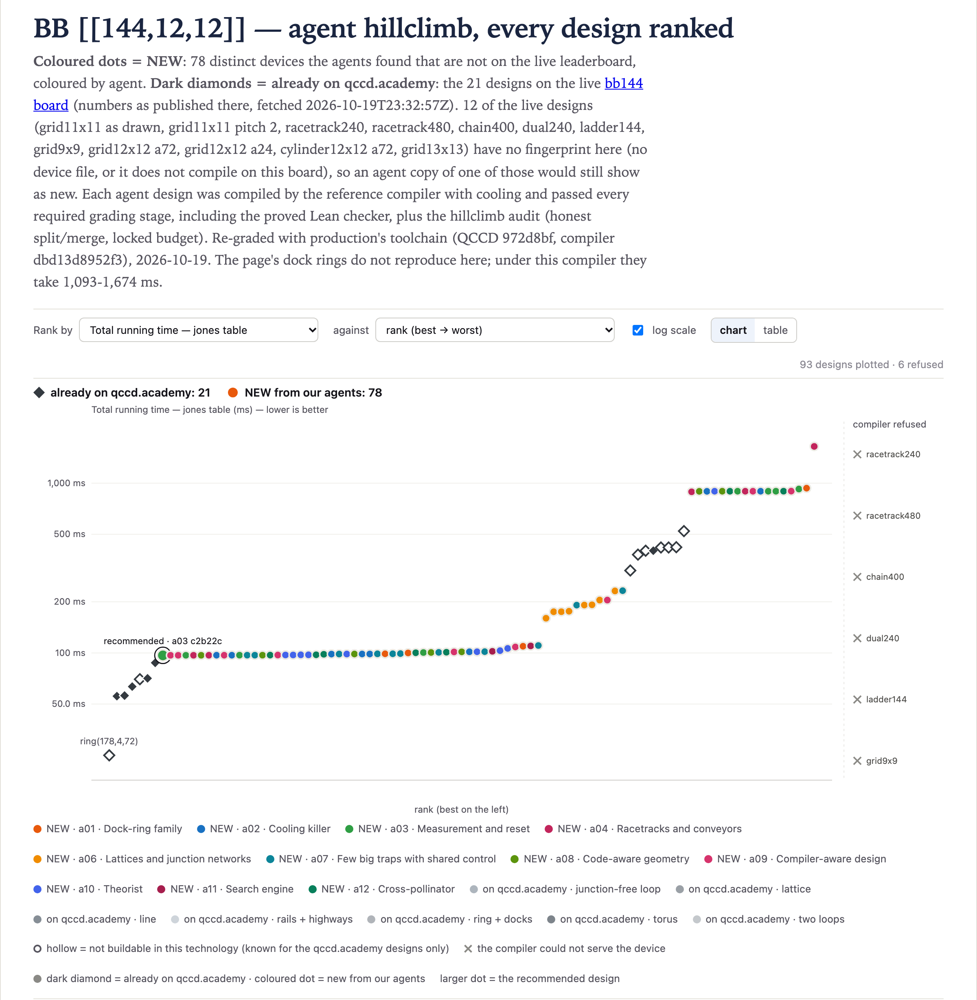

# bb144@1 · BB [[144,12,12]] — 96.74 ms

**Best: 96.74 ms**, against 417.89 ms for the best live design that reproduces here (`grid13x13 broadcast`).
The page also lists lattices that cannot be rebuilt here, with no device file or generator: among
them `grid12x12 a72` at 305.70 ms and `grid12x12 a24` at 419.47 ms. The board's circuit reads its
checks through 24 ancillas. 96.74 ms is 3.16× faster than the a72 row too.
[`01-a03-c2b22c83`](designs/01-a03-c2b22c83.arch.json) is a closed cycle of **168 gate-capable traps**
(an 84 × 2 rectangle) of capacity 15. Every rail segment is on one declared closed loop `L0`, with a
broadcast channel map: no docks, no junctions, 46 DACs. The general router compiles it. Rotation does
not apply, because there are no docks.

| | cool | gates | measure | reset | shuttle | total |
|---|---:|---:|---:|---:|---:|---:|
| ms | 27.0 (90 cools) | 4.69 | 7.56 (63 instructions) | 2.85 | 54.65 (10,929 transport instructions of 5 µs) | **96.74** |

How the agents got there:

1. **One ion per trap.** On grids, tori and other junction networks of 16 to 31 traps, the placer
   packs ions up to each trap's capacity of 12 to 15. These devices route, but every move crosses a
   junction (100–120 µs, +3 quanta), and one ion passes a junction per cycle. The best honest one
   graded 174.8 ms, with its junctions split into two declared loops (a06); with plain lab-frame
   labels the best was 191.1 ms. With 168 traps or more, the placer puts one ion in each, so traps
   always have room and ions walk through each other's traps. On a cycle nothing is a junction: a
   hop is a 5 µs shuttle at +0.1 quanta. `chain(170)` gives 163 ms in a local run during the search,
   but its program is too large for the workspace to accept.
2. **Data first in node order** (134.6 ms in a local run, too large to submit → 110.6 ms graded).
   `Compile.meet` puts a gate in the first trap in node order among the traps with the least summed
   distance, and on a cycle the whole shorter arc ties. Listing the traps that hold data qubits first
   makes the ancilla walk to the data more often, and it made the program small enough to submit.
   Data ions still make most of the hops (about 60–70% in the agents' counts).
3. **One loop** (→ 106.3 ms, and 103.1 ms with the data-first order re-iterated). Declaring every
   segment as the closed loop `L0` gives every clockwise hop one waveform label.
4. **Node and segment order** (→ 96.74 ms). Several agents hill-climbed and annealed the order in
   which the file lists nodes and segments. That changes the router's tie-breaks and nothing else
   about the device.

About 15 ms (gates, measurement, reset) is fixed by the circuit's ASAP layers. The router's 89 MS
layers each need a cool, because the longest walk in a layer is 17 to 90 hops: 90 cools, 27 ms. So
this family pays about 42 ms before transport, and the remaining 55 ms is transport. Peak occupancy
is about 9 ions for a moment, and capacity 6 gave the same time within noise in the agents' local
runs, so the design does not win through long chains.

The top of the board is one family: every design in the table below is this cycle, with a different
node and segment order. Over the run's last half hour, order search gained only 0.2 ms
(96.94 → 96.74 ms).

## The conveyor family, and what the new compiler did to it

Before the cycle took over, the best devices were dock rings for the rotation pass. A 144-slot loop
carries 24 dock spurs on consecutive rail slots, and the dock traps are named so that the compiler's
string-sorted dock order hands dock k to ancilla k. Every check then has its contacts at the same
rotation offsets for almost all 24 ancillas. Under `c7c535380bfb`, the rotation pass batched them into
60 dock/gate/undock batches and 702 one-slot hops: **118.57 ms**. Nine agents reached that number
within the run's first hour. `results.csv` keeps one row per device, so it credits seven: a01 and a05
graded the same devices as a12 and a10.

`dbd13d8952f3` never reorders a qubit's gates, so the pass can no longer commute CX gates into
shared batches. The same devices now take **896.28 ms**, and the 16 dock rings of this family in
`results.csv` take 889 to 934 ms.

## The live page's dock rings

The board's page lists dock rings far faster than anything here: `ring(178,4,72)` at 24.93 ms and
`ring(143,3,36)` (the page's answer) at 55.62 ms. They were rebuilt from their device files or
generator calls and graded with the board's circuit and the reference compiler's own placement.
Under the old compiler they took 480–680 ms. Under production's they take 1,093–1,674 ms, for the
same reason as the conveyor family above. The study's sweep changed the ancilla count, and some of
its rows used a code-aware placement, which a device-only submission cannot pass. The page's bb144
numbers also predate `dbd13d8952f3`. The best live design that reproduces is the lattice
`grid13x13 broadcast`, whose time does not depend on the rotation pass.

## Exploits the agents found

- **Deleting the `dock`/`undock` classes** (not used). The conveyor then falls back to the
  entail-free `shuttle` class for docking, so no split/merge is charged (cools stay at one per
  batch): 99.07 ms on the dock ring under the old compiler. It is eligible, but it dodges the honest
  split/merge rule, so it was never logged. Four agents found it.
- **Every node at the same position** (not used). Without a declared loop, hops are labelled by
  lab-frame direction, so this would give every hop the label "0". The audit now rejects zero-length
  segments.
- **One loop through junctions** (logged). `1792354367-a06-22c1d83f` (160.085 ms, in `results.csv`)
  declares one. The verifier labels hops into and out of an off-loop trap `spur:inward/outward` even
  when both ends of that trap are loop junctions, so opposite moves share one waveform. The honest
  two-loop version of the same torus graded 174.9 ms. It is far from the top, but it relies on that
  quirk.

## The designs

Every graded design ranked, beside the live designs (dark diamonds), as on the board's page:

<!-- designs -->
Ranked under production's toolchain; *at search* is the grade under `c7c535380bfb`. All 78 distinct devices are in [`results.csv`](results.csv).

| # | T_jones (ms) | at search | DACs | traps | junctions | planar | agent | file |
|---:|---:|---:|---:|---:|---:|:---:|---|---|
| 1 | 96.74 | 96.74 | 46 | 168 | 0 | yes | a03 | [`01-a03-c2b22c83.arch.json`](designs/01-a03-c2b22c83.arch.json) |
| 2 | 96.835 | 96.835 | 46 | 168 | 0 | yes | a09 | [`02-a09-801e4c71.arch.json`](designs/02-a09-801e4c71.arch.json) |
| 3 | 96.84 | 96.84 | 46 | 168 | 0 | yes | a09 | [`03-a09-536edd26.arch.json`](designs/03-a09-536edd26.arch.json) |
| 4 | 96.85 | 96.85 | 46 | 168 | 0 | yes | a03 | [`04-a03-f80eb228.arch.json`](designs/04-a03-f80eb228.arch.json) |
| 5 | 96.85 | 96.85 | 46 | 168 | 0 | yes | a04 | [`05-a04-4b464e6a.arch.json`](designs/05-a04-4b464e6a.arch.json) |
| 6 | 96.85 | 96.85 | 46 | 168 | 0 | yes | a08 | [`06-a08-b11a4f38.arch.json`](designs/06-a08-b11a4f38.arch.json) |
| 7 | 96.86 | 96.86 | 46 | 168 | 0 | yes | a04 | [`07-a04-a66891d8.arch.json`](designs/07-a04-a66891d8.arch.json) |
| 8 | 96.93 | 96.93 | 46 | 168 | 0 | yes | a02 | [`08-a02-b68bf8aa.arch.json`](designs/08-a02-b68bf8aa.arch.json) |
| 9 | 96.935 | 96.935 | 46 | 168 | 0 | yes | a09 | [`09-a09-76ccab10.arch.json`](designs/09-a09-76ccab10.arch.json) |
| 10 | 96.94 | 96.94 | 46 | 168 | 0 | yes | a02 | [`10-a02-8ab51a5d.arch.json`](designs/10-a02-8ab51a5d.arch.json) |
<!-- /designs -->

## The live designs, graded the same way

<!-- live -->
The board's page as fetched at 2026-10-19 23:32 UTC; its numbers were not regenerated for `dbd13d8952f3`. Each design was rebuilt and graded here with production's toolchain. *Within the climb's rules* is this climb's audit ([rules](../README.md#how-the-search-ran)).

| live design | on qccd.academy | graded here | eligible | within the climb's rules | rebuilt from |
|---|---:|---:|:---:|:---:|---|
| `ring144_24v stride` | 522.05 | 1128.36 | yes | yes | arch/ring144_24v.arch.json |
| `ring144_24v code-aware` | 69.99 | 1128.36 | yes | yes | arch/ring144_24v.arch.json |
| `ring(95,3,24)` | 87.46 | 1352.82 | yes | yes | Machine.ring(95, 3, 24) |
| `ring(106,4,24)` | 70.825 | 1330.77 | yes | yes | Machine.ring(106, 4, 24) |
| `ring(143,3,36)` (answer) | 55.62 | 1092.945 | yes | yes | Machine.ring(143, 3, 36) |
| `ring(177,5,36)` | 56.045 | 1265.035 | yes | yes | Machine.ring(177, 5, 36) |
| `ring(191,3,48)` | 63.32 | 1223.09 | yes | yes | Machine.ring(191, 3, 48) |
| `ring(178,4,72)` | 24.93 | 1673.82 | yes | yes | Machine.ring(178, 4, 72) |
| `grid13x13` | 417.94 | — | — | no (12,480 DACs) | no device file for this direct-wired version; `grid13x13 broadcast` is the same lattice and programme |
| `grid11x11 as drawn` | 400.045 | — | — | no (8,800 DACs) | no device file or generator to rebuild it |
| `grid11x11 pitch 2` | 400.045 | — | — | no (8,800 DACs) | no device file or generator to rebuild it |
| `grid13x13 broadcast` | 417.94 | 417.89 | yes | yes | Machine.grid(13, 13) (guess) |
| `racetrack240` | — | — | — | — | no device file or generator to rebuild it |
| `racetrack480` | — | — | — | — | no device file or generator to rebuild it |
| `chain400` | — | — | — | — | no device file or generator to rebuild it |
| `dual240` | — | — | — | — | no device file or generator to rebuild it |
| `ladder144` | — | — | — | — | no device file or generator to rebuild it |
| `grid9x9` | — | — | — | — | did not compile here |
| `grid12x12 a72` | 305.695 | — | — | no (10,560 DACs) | no device file or generator to rebuild it |
| `grid12x12 a24` | 419.465 | — | — | no (10,560 DACs) | no device file or generator to rebuild it |
| `cylinder12x12 a72` | 379.355 | — | — | no (11,040 DACs) | no device file or generator to rebuild it |

The page's numbers replay the study's own schedules (`T_source: replay`). Here each design is compiled by the reference compiler with its own placement. The two differ for `ring144_24v stride`, `ring144_24v code-aware`, `ring(95,3,24)`, `ring(106,4,24)`, `ring(143,3,36)`, `ring(177,5,36)`, `ring(191,3,48)`, `ring(178,4,72)`, `grid13x13 broadcast`.
<!-- /live -->
