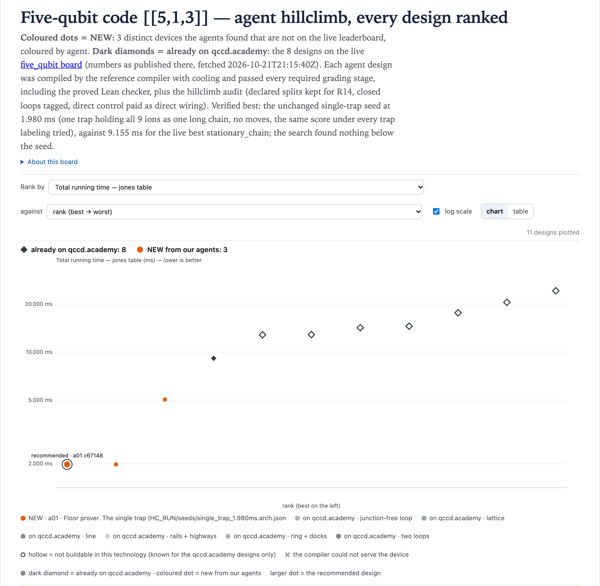

# five_qubit@1 · Five-qubit code [[5,1,3]] — 1.980 ms (v2)

**Best: 1.980 ms**, against 9.155 ms for the best live design (`stationary_chain`), 4.62× faster.
[`01-a01-c671484c`](designs/01-a01-c671484c.arch.json) is one trap holding all 9 ions: zone `G`
(gates and readout), capacity 9, direct control, 24 DACs, no rails. It is the single-trap seed the
climb started from, unchanged (same device and program digests). **The search found nothing below
the seed.** The same device is also the best result that does not depend on trap ids (every
labeling the verifier tried scores 1.980 ms) and the best with `long_chain_splits` = 0 (it never
moves an ion). It wins through one 9-ion chain, which `T_jones` does not charge for.

One agent (`a01`) worked this board for one hour, with the brief to prove the seed optimal or beat
it. It logged 3 grades (3 distinct devices, all eligible and audited) and wrote a hand proof (not
machine-checked, [below](#the-floor)) that no device scores below 1.980 ms under the platform's
compiler (qccdc `c774b87b677f` + `insert_cooling`). A separate verifier (`a90`) re-graded every design
fresh, tried relabelled and mirrored copies, and probed 56 more devices with `hc-fast` to refute the
proof. Nothing scored below 1.980 ms.

## The designs

Graded with `hc-grade` (QCCD `compiler` at `84e8c5d`, qccdc `c774b87b677f`, qcheck `e8acd6640fd3`).
*Worst labeling* is the highest score over the verifier's relabelled and mirrored copies.

| # | file | T_jones (ms) | worst labeling (ms) | long_chain_splits | traps / junctions / DACs | idea |
|---:|---|---:|---:|---:|---|---|
| 1 | [`01-a01-c671484c`](designs/01-a01-c671484c.arch.json) | **1.980** | 1.980 | 0 | 1 / 0 / 24 | all 9 ions in one `G` trap, no moves (the seed) |
| 2 | [`02-a01-d9a20575`](designs/02-a01-d9a20575.arch.json) | 1.980 | 1.980 | 0 | 2 / 0 / 48 | #1 plus a 4-ion measure-only (`Mo`) trap that the compiler never uses |
| 3 | [`03-a01-ed0b4a6a`](designs/03-a01-ed0b4a6a.arch.json) | 5.045 | 5.045 (best 4.680) | 5 | 2 / 0 / 48 | a proof probe: #1 plus a 1-ion `G` trap, which pulls ions out of the chain |

[`results.csv`](results.csv) has every graded design and, as extra rows with agent `v1:<agent>`, the
first round's seven PR designs re-graded under v2. For those rows, `rank` and `file` are blank, `dacs`
is the count the v2 grader uses (with its wiring floors), `audit_ok` and `long_chain_splits` are
filled only for 05 and 07, which the climb graded as seeds, and no relabelled copies were graded
(`id_dependent` is `unchecked`, `T_ms_worst_labeling` blank).

## Why the best is fast

| | cool | gates | measure | shuttle | total |
|---|---:|---:|---:|---:|---:|
| µs | 300 | 1200 | 480 | 0 | **1980** |

The program has 134 instructions: init, the state-prep cool, 128 gates and 4 measures. The gates are
16 MS (25 µs each), 88 R (5 µs) and 24 VZ (15 µs): 400 + 440 + 360 = 1200 µs, all serial, because
R12 allows one gate per trap per instruction. There is no transport and no inserted cool.

Every device pays the 300 µs state-prep cool and 480 µs of measures. The compiler emits one measure
instruction per circuit layer that holds one, and the 4 measures fall in 4 different layers. So
`T = 780 µs + G + S + 300 µs × C`, with G the gate instructions, S the transport and C the inserted
cools. A device with more gate traps can run gates in parallel (the general router's floor is
725 µs), but only by moving ions. A move out of a shared trap pays an 80 µs split, a move into an
occupied trap an 80 µs merge (both, if both), on top of the hops, and each puts 6 quanta on the
moving ion. From then on `insert_cooling` puts a 300 µs cool before every MS instruction that holds
that ion. Every ion takes part in 3 or 4 of the 16 MS, so a few moves cost more cooling than the
parallel gates save.

## The floor

- **Measured.** Every device graded or swept here pays the 300 µs state-prep cool and 480 µs of
  measures. In an `hc-fast` sweep before the climb (4,294 distinct 1-5 trap paths and cycles, zones
  `G` and `Go`), every multi-trap device that compiled moved ions and got at least 5 inserted cools;
  the best scored 4.460 ms. The verifier's 56 `hc-fast` probes scored 1.980 ms or more (below).
- **The cooling rule (read in the source by `a01` and the verifier).** `insert_cooling`
  (`qccd/compile/cooling.py`) replays the compiled program without the cools it inserts, and puts a
  300 µs cool before every MS instruction holding an ion above 1 quantum. So after one split or merge
  (6 quanta), an ion pays a cool before **every** later MS instruction it is in, not only the next.
- **Proved for this compiler (`a01`'s proof; premises read in the source, numbers checked by its
  scripts `floor_check.py`, `c1_bound.py` and `c2_bound2.py`; not machine-checked; the verifier could
  not refute it): no device scores below 1.980 ms.** Beating it needs `G + S + 300 C < 1200 µs`.
  - C ≥ 2: the general router emits per circuit layer and per pulse round, so G ≥ 725 µs, and
    725 + 600 > 1200. The race-track pass merges before every MS (C ≥ 4, T ≥ 2.43 ms). The rotate
    pass can never compile this circuit (every qubit has an H, only docked ions can gate, and a CX
    with both operands docked is refused). C ≥ 2 is also closed for any scheduler: C ≥ 3 leaves
    G < 300 µs, below the 450 µs longest chain of gates linked by shared ions, and for C = 2, over
    all 2,881 feasible choices of moved ions and hot MS, the busiest starting trap does at least
    800 µs of serial work against the < 515 µs needed.
  - C = 1 (any scheduler): every other MS instruction holds only cold ions. Ions that are cold and
    share a trap shared it from the start, since the grouping changes only through a split or merge.
    The 16-MS interaction graph has no matching cut, so all 9 ions start in one trap and all but one
    MS instruction run there, in series. Over every choice of the hot instruction, the work that can
    run outside that trap falls at least 115 µs short of 300 + S; the best case is 270 µs against
    300 + S ≥ 385 µs (ions that leave and come back pay a second move).
  - C = 0 (`compile.ml`, the only pass here that can avoid inserted cools): every MS runs in the
    starting trap. A CX's tail pulses run in its own round at the MS's trap, so a finished ion can
    only take its next H (20 µs) elsewhere. Those H's fall in four layer groups, each needing its
    own move (≥ 85 µs) for ≤ 40 µs of overlap.
- **Gaps.** The proof is about qccdc as it is, not about the physics.
  - C = 0 under a different scheduler is open: batching the finished ions out in one move might save
    about 35 µs (`a01`'s estimate, not a bound).
  - Reading out all 4 ancillas in one instruction would give 300 + 120 + 1200 = 1.62 ms in one trap
    (arithmetic, not graded), but qccdc emits one measure instruction per circuit layer.
  - Neither can be reached by changing the device.
- **What-if (`a01`'s `smartcool.py`, not graded).** If `insert_cooling` counted the cools it has
  already inserted, qccdc's own programs would score: #3 3.845 ms (from 5.045), the v1 frontier
  seed (a 5-trap path) 8.335 (from 8.635), `stationary_chain` 8.555 (from 9.155), v1 PR 05 8.71
  (unchanged). All stay far above 1.98 ms because the router's moves dominate.

## Trap labels change the score

#1 and #2 do not depend on ids: every relabelled and mirrored copy scored 1.980 ms with 0 moves. #3
does. As logged it scores 5.045 ms: cool 2700 (8 inserted cools), gates 1100, shuttle 765 (9 moves),
measure 480 µs. With its two trap ids swapped, positions unchanged, it scores **4.680 ms**: cool
2400 (7 inserted cools), gates 1120, shuttle 680 (8 moves), measure 480 µs. A copy renamed
`T0` → `Z2`, `T1` → `Z1` (the same reversed id order) also gives 4.680. The mirror image keeps the
logged program (same program digest `2f86cd8a406da9cd`), and the mirror with swapped ids gives the
swapped one (`52bc957a07a0ff58`). So the score follows the ids, not the geometry: the compiler breaks
placement ties by trap id (#20 fixed file order, not ids). It is not a property of the device. #3 is
a probe, far above #1 either way.

## #22 exposure

`long_chain_splits` (from `hc-chainsplits`) counts moves that leave ions behind at a trap holding
more than 2 ions: the moves R14 would judge if #22 were fixed. Today R14 judges only splits that a
class declares.

- #1 and #2: 0 (no moves). The best result is unaffected by #22.
- #3: 5 as logged, 4 with the ids swapped.
- The live best `stationary_chain`: 19 (22 moves, 13 inserted cools).
- v1 PR designs 05 and 07 (graded as seeds): 27 and 25. 06, also still eligible, was not measured. The
  v1 frontier seed (a 5-trap path): 25.

## Long chains

The best device holds all 9 ions in one 9-ion chain for the whole program. R13 allows up to 15 ions
at a gate, an MS instruction costs 25 µs for any chain length, and `T_jones` does not charge chain
length, so the long chain costs nothing here. #2 has the same chain, and #3 starts with all 9 ions in
its large trap. The live best `stationary_chain` also starts with 9 ions in one trap. Whether the
maintainer wants such long-chain, low-motion devices counted as `T_jones` results, or will add a
chain-length cost, was asked on #10 (2026-10-21) and is not yet answered.

## What did not work

- **A second gate trap of any size.** The router claims the main trap for the first op of a layer
  and sends the next op's ion to the other gate trap. In layer 0 it moves `q1` out before its 3 MS,
  and every later MS of a moved ion pays a cool. Logged #3 (`G9` + `G1`): 5.045 ms, 8 inserted cools.
  `G9` + `S1` + `G1` (an `hc-fast` probe, not logged): 5.09 ms, 8 cools. The verifier's `hc-fast`
  probes with a second gate trap: 4.68-8.99 ms, 6-13 inserted cools.
- **Separate readout.** A 9-ion gate-only trap beside a 4-ion measure-only trap scores 2.560 ms (a
  probe before the climb, `long_chain_splits` 4): the 4 ancillas move out after their last MS to be
  measured (85 + 3 × 165 = 580 µs), with no inserted cool. The verifier's `Go9` + `Mo` probes:
  2.56-2.89 ms.
- **Traps that cannot gate**, beside the gate trap: never used, so they only add DACs (#2; 1.980 ms in
  every such verifier probe).
- **Rotation.** A ring with docks under `--compiler rotate` is refused: "h acts on q1, which rides
  the loop".

## Exploit review

The verifier found no exploit:

- `a01`'s notes list none, and its files show no search over ids, names or file order, no program
  edits and no placements. Its one relabel (`T0` → `Q7`) was an orientation check.
- The verified best is the unchanged seed. It has no moves, no loops, only the `shuttle` class (no
  class with `entails` removed), direct control paid with direct wiring (24 DACs per trap, no channel
  map), no zero-length hops, and 9 ions at a gate, within R13's limit of 15.
- Its only notable feature is the long chain. The brief allows it, so it is flagged above but not
  counted as an exploit.

## Live designs graded here

The board's page as fetched at 2026-10-21 21:15 UTC. Each design was rebuilt here and graded with
`hc-grade`. Every one reproduces the page's number exactly, and all are eligible and pass this climb's
audit.

| live design | on qccd.academy (ms) | graded here (ms) | traps / junctions / DACs | rebuilt from |
|---|---:|---:|---|---|
| `stationary_chain` (answer) | 9.155 | 9.155 | 2 / 0 / 48 | arch/stationary_chain.arch.json |
| `h2_racetrack` | 12.85 | 12.85 | 40 / 0 / 72 | arch/h2_racetrack.arch.json |
| `cyclone_base` | 12.895 | 12.895 | 72 / 0 / 38 | arch/cyclone_base.arch.json |
| `cyclone_dual_loop` | 14.245 | 14.245 | 144 / 0 / 44 | arch/cyclone_dual_loop.arch.json |
| `deck_unit_cell` | 14.54 | 14.54 | 144 / 77 / 44 | arch/deck_unit_cell.arch.json |
| `ladder_2x72` | 17.665 | 17.665 | 288 / 46 / 56 | arch/ladder_2x72.arch.json |
| `ring24_8` | 20.53 | 20.53 | 32 / 8 / 35 | Machine.ring(12, 2, 8) (guess) |
| `ring144_24v` | 24.255 | 24.255 | 168 / 24 / 46 | arch/ring144_24v.arch.json |

## The first round (v1)

v1's best was 1.62 ms (`01-a01-ceea5d90`, six traps on a cycle, broadcast wiring), against 1.815 ms
for `stationary_chain` under the v1 toolchain. The platform fixes broke it in two ways. Moves now
pay split and merge for what they do, and every later MS of an ion that split or merged pays a cool.
And R20 requires rails at a node to meet at 60 degrees or more. v1's designs 01-04 now fail R20
(rails meeting at 0-23.6 degrees; 02 also fails R21), and 05-07 are eligible at 8.71, 9.26 and
8.885 ms ([`results.csv`](results.csv), agent `v1:*`). The v1 files are in this PR's history
(`44bee62`).
