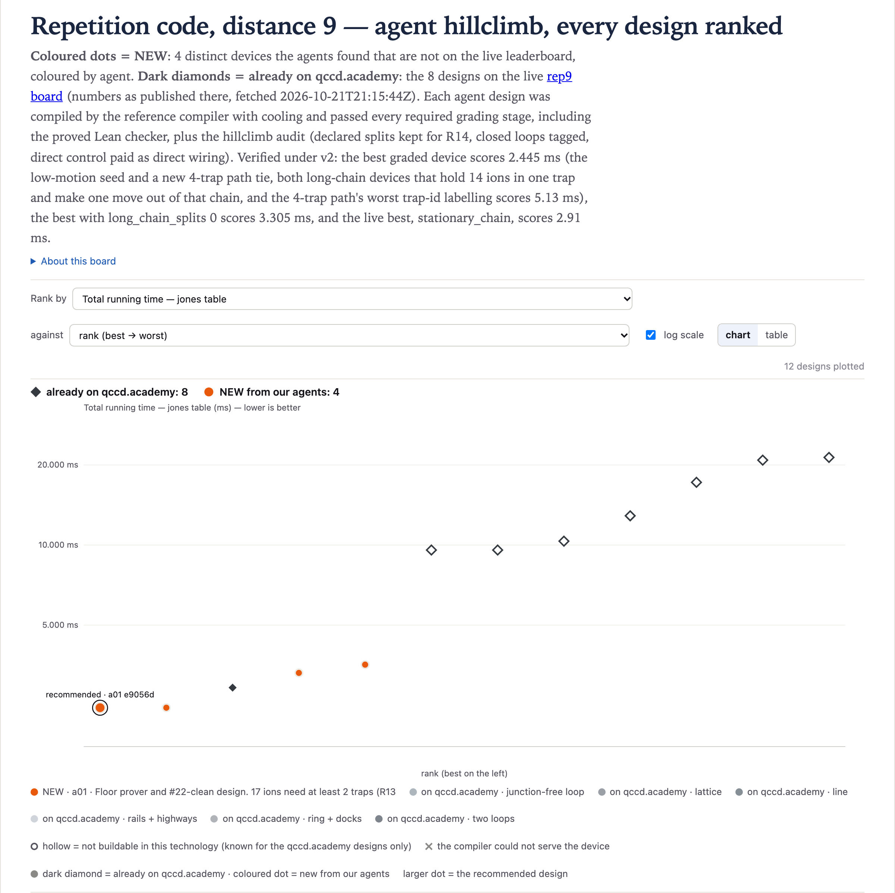

# rep9@1 · Repetition code, distance 9 — 2.445 ms (v2)

**Best: 2.445 ms**, against 2.91 ms for the best live design (`stationary_chain`), graded the same
way. Two devices tie at 2.445 ms. One is the low-motion seed the search started from, graded
unchanged: [`01-a01-e9056d95`](designs/01-a01-e9056d95.arch.json), 3 traps on a path with capacities
2/14/4.
The other is new: [`02-a01-a1d85afb`](designs/02-a01-a1d85afb.arch.json), 4 traps on a path with
capacities 2/14/4/2. Both are long-chain devices: 14 ions start in one trap, and one ion makes the
only move, out of that 14-ion chain. **The search did not beat the seed.** a01 proved, and the
verifier checked, that no program from qccdc's general router can go below 2.445 ms on this board.

No graded device scores the same under every labeling of its trap ids. The new 2.445 ms device
keeps 2.445 ms in both physical orientations, where the seed drops to 2.91 ms, but 16 of its 24
trap-id labelings score worse, the worst 5.13 ms (the seed's worst is 5.4 ms). The best device with
`long_chain_splits` = 0, meaning no move leaves ions behind at a site holding more than 2 ions (what
R14 would judge if upstream #22 were fixed), is new:
[`03-a01-8cf213c8`](designs/03-a01-8cf213c8.arch.json), **3.305 ms**, against 3.705 ms for the best
such seed. Its worst labeling scores 3.645 ms, with `long_chain_splits` 1. It also wins through a
long chain: 15 ions share one trap for 14 of the 16 CX, but no ion ever leaves that chain.

Every number here is from the v2 toolchain: QCCD `compiler` at `84e8c5d`, qccdc `c774b87b677f` (the
published Linux build, sha256 `ed8838c6…`) and qcheck `e8acd6640fd3` (sha256 `c18484bd…`). The
exceptions are the scores published on qccd.academy and the v1 scores, each marked as such.

The coloured dots are the 4 devices graded in the search (the chart's header says the agents found
all four, but 01 is the seed), and the dark diamonds are the 8 live designs at their published
numbers, hollow where the page marks the design not buildable. The larger dot, which the chart labels
"recommended", is the board's first 2.445 ms grade: the unchanged seed. a01 and the verifier prefer
02, the other dot at 2.445 ms, because it keeps 2.445 ms in both orientations.

## How the search ran

One agent, a01, worked on this board for 1 hour on 2026-10-22, 20:45–21:45 UTC. Its brief, written
from measurements made before the run, set two jobs: prove 2.445 ms is the floor or beat it, and find
the best design with `long_chain_splits` = 0. a01 was a Claude Code (Opus 5.5) subagent. It ran every
command on the VM as a sandboxed user, firewalled from qccd.academy, with no publishing credentials
and no write access to the grader or compiler. A result counted only through `hc-grade`, which runs
the reference compiler (qccdc + `insert_cooling`), all 10 grading stages including the Lean
certificate, and this climb's audit.
a01 logged 4 grades of 4 distinct devices, all eligible and audit-clean. A verifier (a90) then:

- re-graded all 4 from scratch;
- counted #22 exposure with `hc-chainsplits`;
- traced each certified program;
- graded mirrored and id-permuted copies;
- reviewed exploits.

All 4 scores, device digests and program digests reproduced exactly.

## The designs

[`results.csv`](results.csv) lists every grade, plus the three v1 designs re-graded under v2 (agents
`v1:…`, no rank). *Worst labeling* is the worst score over every assignment of the device's trap
ids to its positions. Each file is the graded document with only `name` and `description` changed.
A script checked that every other key is the same JSON value.

| file | T_jones (ms) | worst labeling (ms) | long_chain_splits | traps / junctions / DACs | idea |
|---|---:|---:|---:|---|---|
| [`01-a01-e9056d95`](designs/01-a01-e9056d95.arch.json) | 2.445 | 5.4 | 1 | 3 / 0 / 72 | the brief's low-motion seed, unchanged: path 2/14/4, zone G, segment capacity 2, direct wiring; one move |
| [`02-a01-a1d85afb`](designs/02-a01-a1d85afb.arch.json) | 2.445 | 5.13 | 1 | 4 / 0 / 96 | the same schedule on path 2/14/4/2; the end trap T3 never holds an ion, and with it the reversed labeling also scores 2.445 |
| [`03-a01-8cf213c8`](designs/03-a01-8cf213c8.arch.json) | **3.305** | 3.645 | **0** | 6 / 0 / 80 | path 1/1/1/2/1/15, zones G/Mo/Go/Go/Mo/G, segment capacity 1, wise wiring; 5 transport cycles, every move out of a trap holding ≤ 2 ions, then 15 ions in T5 |
| [`04-a01-398bbd34`](designs/04-a01-398bbd34.arch.json) | 3.55 | 5.275 | 0 | 5 / 0 / 120 | path 15/1/1/2/2, zones G/G/G/Go/Go, segment capacity 1, direct wiring; 6 transport cycles, every move out of a trap holding ≤ 2 ions, then 15 ions in T0 |

Zones: G gates and reads out, Go only gates, Mo only reads out. Every trap sits on an open path
(no junctions, no loops), and every node declares its capacity with `capacity_explicit`. Files are
numbered by T_jones, with ties in board order. a01 logged the seed first, as the brief asked, so
that the board held the incumbent.

## Why the best is fast

The two 2.445 ms devices run the same schedule (traced from their certified programs):

- The placer puts q0–q6 and q9–q15 (14 ions) in T1, and q7, q8, q16 in T2. No other trap ever holds
  an ion.
- The circuit is a staircase. Its interaction graph is one path, q0–q9–q1–q10–…–q7–q16–q8, and the
  16 CX run in path order.
- The first 13 CX, up to q6–q15, run inside T1.
- Then q15 moves T1 → T2 in one hop: 5 µs + split 80 µs + merge 80 µs = 165 µs. One cool is
  inserted before its next MS.
- The last 3 CX run in T2, which holds 4 ions.

| | cool | gates | measure | transport | total |
|---|---:|---:|---:|---:|---:|
| µs | 600 | 720 | 960 | 165 | **2445** |

The breakdown is `cost_breakdown.qccdsim_jones.us_by_type` from `report.json`, where transport is
`simd`:

- **Cool**: the state-prep cool and one inserted cool, 300 µs each.
- **Gates**: 80 serial instructions, 16 MS at 25 µs and 64 `R` at 5 µs.
- **Measure**: 8 instructions at 120 µs, one for each ASAP layer that holds a measurement.

Only the transport and the inserted cools depend on the device, and here they are one move and one
cool.

The 3.305 ms device works differently: 1.980 + 0.425 (transport) + 3 × 0.300 (inserted cools) =
3.305 ms. The placer starts q0 alone in T2, q1 and q9 together in T3, and the other 14 ions in T5.
Five 85 µs cycles follow:

1. q1 steps aside to T4 while q0 joins q9 in T3 (MS q0–q9).
2. q0 goes back to T2.
3. q1 comes back to T3 (MS q1–q9).
4. q1 steps out to T4 again.
5. q9 follows to T4 to be read out, while q1 joins the 14 in T5.

With q9 parked in T4, the compiler's undock step cannot send q1 home out of the 15-ion chain. T0 and
T1 never hold an ion. a01 found the device in a random sweep of 14,000 wise-wired 6–7 trap paths,
7,897 of which compiled.

## The floor

- **Proved** (a01; the verifier checked it step by step and did not refute it). Every program
  qccdc's general router emits on this board costs T = 1.980 ms + S + 0.300 ms × C, with S the
  transport and C the inserted cools, and T ≥ 2.445 ms.
  - The 1.980 ms is the state-prep cool, 720 µs of gates and 960 µs of readout. It is fixed because
    `compile.ml` defers ops only to the next round of the same layer and emits one measure
    instruction per layer.
  - Write the path as P0…P16 = q0, q9, q1, q10, …, q16, q8, so that CX k acts on P_k and P_k+1.
  - C = 0 is impossible. With no heated ion at any MS, every CX pair shares an initial chain, so all
    17 ions would share one, and qccdc offers at most 15 ion slots per trap.
  - C ≥ 2 gives T ≥ 1.980 + 0.600 + 0.085 = 2.665 ms.
  - C = 1, with the cool before CX k*. Then every ion is unheated (never split, never merged) at all
    its MS except P_k* at CX k*. So P0…P_k* and P_k*+1…P16 start as two chains, and P_k* must arrive
    at the second one (a merge). Either P_k* also splits in that cycle (≥ 165 µs), or at least 2
    finished ions left its chain in an earlier cycle (≥ 85 + 85 µs), because 17 ions do not fit in
    one 15-slot trap. So S ≥ 165 µs and T ≥ 1.980 + 0.165 + 0.300 = 2.445 ms.
  - The verifier found one gap: P_k* could split from its chain in an earlier cycle and merge later.
    That costs at least 170 µs, so the bound holds.
- **The cooling rule behind C.** `insert_cooling` (`qccd/compile/cooling.py`) replays the program
  once without cools. It puts a 300 µs global cool before every MS instruction that breaks R7
  (n-bar ≤ 1) in that replay. A split or merge adds 6 quanta, so an ion that has split or merged
  pays a cool before *every* later MS instruction it is in, not only the next one.
- **The brief's open step closes negatively.** Its 2.365 ms paper schedule has q16 and q8 arrive
  while q0 and q9 leave, all in one 85 µs cycle. It fails because the arriving q16 then gates in two
  CX, so it needs 2 cools (≥ 2.665 ms).
- **Not covered by the proof**: the race-track, rotate and rigid-rotation passes. Measured: 8.665 ms
  and above for race tracks, 15.18 ms for the best dock ring and 16.38 ms for the starter `ring16`.
- **Measured.** Before the run, hc-fast sweeps compiled 14,427 devices within the rules (paths,
  cycles and stars of 2–10 sites), and none went below 2.445 ms.
- **With `long_chain_splits` = 0 (sketches, not results).**
  - The brief argued for a 2.91 ms floor from one shape: q0 and q9 together, q9 meets a lone q1,
    and q1 joins the other 14.
  - a01 lowered the bound for that shape to 2.83 ms, with CX1 as one 85 µs cycle that evicts q0.
    That the router would do this was not verified.
  - a01 also argued that qccdc's placer (`place.ml`) never starts in that shape. With the reference
    placer, `long_chain_splits` = 0 then needs C ≥ 3, so T ≥ 1.980 + 0.900 + 3 × 0.085 = 3.135 ms.
    The range from 3.135 to 3.305 ms is open.
  - The brief forced that placement through `qccdc compile --init-placement` on a 4-trap path and
    measured 2.915 ms with `long_chain_splits` 0. `hc-grade` never passes a placement, so that is
    not a result.

## Trap labels change the score

The compiler breaks placement ties by trap id. Upstream #20 made it read the device in canonical
order, so file order no longer matters, but ids still do. The verifier graded every assignment of
each device's trap ids to its positions with `hc-chainsplits`, which agreed with `hc-grade` on all
14 copies graded both ways. It graded the reversed, mirrored and worst copies with `hc-grade
--no-log`, and all of them were eligible and audit-clean.

| file | as shipped | ids reversed | mirrored (x → −x) | all labelings: ms (long_chain_splits) × count | worst |
|---|---:|---:|---:|---|---:|
| `01-a01-e9056d95` | 2.445 | 2.91 | 2.445 | 2.445 (1) × 1, 2.91 (2) × 3, 5.4 (7) × 2 | 5.4 |
| `02-a01-a1d85afb` | 2.445 | 2.445 | 2.445 | 2.445 (1) × 8, 2.91 (2) × 14, 4.5 (7) × 1, 5.13 (8) × 1 | 5.13 |
| `03-a01-8cf213c8` | 3.305 | 3.305 | 3.305 | 3.305 (0) × 672, 3.565 (1) × 24, 3.645 (1) × 24 | 3.645 |
| `04-a01-398bbd34` | 3.55 | 3.55 | 3.55 | 3.55 (0) × 114, 5.275 (4) × 6 | 5.275 |

- *As shipped*, the ids run T0, T1, … along the path.
- *Ids reversed* keeps the positions and runs the ids backwards, which is the device's physical
  mirror image labeled the shipped way.
- *Mirrored* moves every node to −x and keeps the ids. It compiles to the same program as shipped.
- Rotating by 90°, reversing the segment ids and renaming the trap ids in order (Q0, Q1, …) also
  changed nothing.

Of the changes tried, only the order of the ids along the path moved the score. So the spread comes
from the compiler's tie-break by id, not from the device. The same 4-trap hardware compiles to
2.445 ms, or to 5.13 ms with the ids T0, T3, T1, T2 from left to right.

a01's generators always wrote the ids left to right, and a01 never searched ids, names or order. The
selected devices still benefit from that labeling's tie-breaks.

## #22 exposure

R14 judges only splits that a move's class declares. Splits the replay reads off the chains are
charged (80 µs, 6 quanta) but not judged (upstream #22). If #22 is fixed, a split out of a site
holding more than 2 ions needs swaps to the chain's end (`gate_swaps`). qccdc never writes those,
so such a program would fail R14 as compiled today. `hc-chainsplits` counts these moves:

| design | T_jones (ms) | long_chain_splits |
|---|---:|---|
| `01-a01-e9056d95` (the seed) | 2.445 | 1: q15 leaves the 14-ion chain |
| `02-a01-a1d85afb` | 2.445 | 1: the same move |
| `03-a01-8cf213c8` | 3.305 | 0 |
| `04-a01-398bbd34` | 3.55 | 0 |
| live `stationary_chain` | 2.91 | 2 |
| the brief's `long_chain_splits` 0 seed, path 2/2/2/14 | 3.705 | 0 |

With #22 fixed and qccdc unchanged, both 2.445 ms programs and `stationary_chain`'s would fail R14
by this count. 03 and 04 make no such move as shipped, but 48 of 03's 720 labelings and 6 of 04's
120 do.

## Long chains

T_jones does not charge chain length. An MS instruction takes 25 µs for any chain, and R13 allows
15 ions in a trap at a gate. Every device here wins through a long chain (traced from the certified
programs):

- 01 and 02: 14 ions in T1 at the first 13 MS, then 4 ions in T2 at the last 3.
- 03: 2 ions at the first 2 MS, then 15 ions in T5 at the other 14.
- 04: 2 ions at the first 2 MS, then 15 ions in T0 at the other 14.
- `stationary_chain`, the live best: 15 ions in one trap. q1 leaves that chain for the other trap
  and comes back (165 µs each, 2 inserted cools): 1.980 + 0.330 + 0.600 = 2.910 ms.

Should such devices rank on T_jones, or should a chain-length cost be added? That question is open
on #10 (asked 2026-10-21).

## What did not work

All measured by a01, the sweeps with `hc-chainsplits`:

| tried | how many | result |
|---|---|---|
| exhaustive 5-trap paths: one 15-slot G trap at position 0–2, the others 1–2 slots in zones G/Go/Mo/S, segment capacity 1 | 12,288 (9,878 compiled) | best 2.91; `long_chain_splits` 0 only twice, both 3.55: 04, and 04 with T1 in zone Go |
| exhaustive 4-trap paths with segment capacity 2: big trap 14/15, the others 1–3 slots | 6,912 | no `long_chain_splits` 0; best 2.91 |
| random 5-trap paths with 3-slot traps or a 14-slot big trap | 9,000 | best with 0: 3.64 |
| random wise-wired 6–8 trap paths | 12,000 | best with 0: 3.63; best overall 2.61 |
| final random wise-wired 6–8 trap paths, 1–2 slots | 5,000 | best with 0: 3.69 |
| exhaustive variants of 04: big trap 14/15, each segment capacity 1/2, zones of T1–T4 | 8,192 | 32 with 0, all 3.55 |
| a 3-slot trap for q0 and q9, aiming at an 85 µs CX1 meeting | 2,048 | none with 0; best 2.925, with `long_chain_splits` 4 |
| local search from 04 | 10,720 candidates, 3 walkers | stuck at 3.55 |
| local search from 03: capacities 1–3, zones, traps inserted or deleted, 3–8 traps | 15,200 candidates, 3 walkers | nothing below 3.305 with 0 |
| the path S–S–Go2–G1–G15, aimed at the 2.83 ms shape | 1 | the placer starts it mirrored, with q8 and q16 together, and it does not compile |
| symmetric 3-trap paths a/b/a, a 1–5, b 13–15 | 30, among the 288 below | best 2.91 |
| 3-trap paths that score 2.445 ms | 12 of 288 tested | all orientation-dependent: with the capacities reversed (ids still left to right) they score 2.91–4.47 |

## Exploit review

The verifier (a90) reviewed exploits. a01 listed no possible exploits, and the verifier found none:

- **Ids and order.** No id, name or order search, no placement passed and no program edits. a01's
  generators write the trap ids T0…T(n−1) left to right and the segments E0… by position.
- **Physics and classes.** All 4 devices match the seed in physics, zone types, budget and class
  blocks (the `x_junction_grid` generator plus `shuttle`). They have no dock classes, no loops and
  no loop tags, so the declared-split and honest-loop rules hold trivially.
- **Wiring.**
  - The direct-control devices pay direct wiring, 24 DACs per trap (72, 96 and 120).
  - 03 uses `simd_classes` with wise wiring and no channel map: max(32, 32) + 6 × 8 = 80 DACs, which
    the grader accepts.
  - In each of 03's two 2-ion cycles, both ions move the same way (+x), so R22 passes.
- **Geometry.** No zero-length hops, and the straight paths satisfy R20 and R21.
- **Parking q9.** 03 and 04 park q9 so that the undock step cannot pull q1 back out of the big
  chain. That is the compiler responding to the layout, by the same mechanism as the brief's
  forced-placement probe, not a grader exploit.

## Live designs graded here

The board's page was fetched on 2026-10-21 at 21:15 UTC, with 8 ranked rows under the new physics.
Each design was rebuilt and graded with `hc-grade` on the VM.

| live design | on qccd.academy | graded here | eligible | within the climb's rules | rebuilt from |
|---|---:|---:|:---:|:---:|---|
| `stationary_chain` (answer) | 2.91 | 2.91 | yes | yes | arch/stationary_chain.arch.json |
| `h2_racetrack` | 9.575 | 9.575 | yes | yes | arch/h2_racetrack.arch.json |
| `cyclone_dual_loop` | 9.575 | 9.575 | yes | yes | arch/cyclone_dual_loop.arch.json |
| `ladder_2x72` | 10.34 | 10.34 | yes | yes | arch/ladder_2x72.arch.json |
| `deck_unit_cell` | 12.88 | 12.88 | yes | yes | arch/deck_unit_cell.arch.json |
| `cyclone_base` | 17.21 | 17.21 | yes | yes | arch/cyclone_base.arch.json |
| `ring144_24v` | 20.855 | 27.86 | yes | yes | arch/ring144_24v.arch.json |
| `ring24_8` | 21.35 | 18.48 | yes | yes | Machine.ring(12, 2, 8) |

Two rows differ. The page's numbers replay the study's own schedules (`T_source: replay`), with 179
transport instructions for `ring144_24v` and 86 for `ring24_8`. qccdc emits 47 for each. `ring24_8`
has no arch file, so it was rebuilt with `Machine.ring(12, 2, 8)`, the generator its page title
names.

## The first round (v1)

v1 reported 1.305 ms here for a 20-site race track (`01-a01-fffd85a7`), against 1.99 ms then for
`stationary_chain`. Under the fixed platform, the race-track pass still merges each pair into its
gate trap and splits it after, and both are now charged. It scores 8.665 ms, which includes 32
one-ion steps at 85 µs and 16 inserted cools; it still reads all 8 ancillas in one 120 µs
instruction. The second race track scores 9.585 ms and the dock ring 15.18 ms; all three are the
`v1:` rows of `results.csv`. Their files are in this PR's history.
