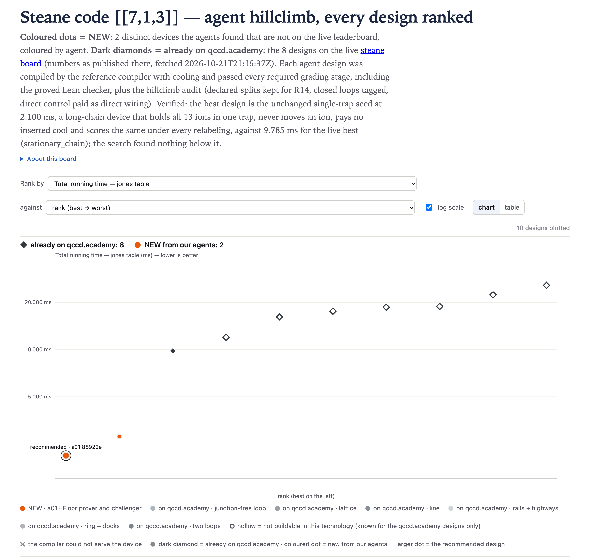

# steane@1 · Steane code [[7,1,3]] — 2.100 ms (v2)

**Best: 2.100 ms**, against 9.785 ms for the best live design (`stationary_chain`), 7.685 ms lower.
[`01-a01-88922e3c`](designs/01-a01-88922e3c.arch.json) is one trap that can gate, read out and cool,
holding all 13 ions (capacity 13), direct wiring, 24 DACs. Nothing moves and no cool is inserted. It
scores 2.100 ms under every relabeling and mirror the verifier tried, and its `long_chain_splits` is
0, so it is also the best id-independent design and the best design with no #22 exposure. It wins
through one 13-ion chain, which `T_jones` does not charge.

**The search did not beat the seed.** The best design is the single-trap seed byte for byte, graded
before the run at 2.100 ms. Nothing graded or swept on this board went below it. The low-motion seed
(two traps, capacities 1 and 15) scores 2.870 ms as given and 3.450 ms with its two trap ids
swapped. The second design on the board, a probe that moves ions without forcing a cool, scores
2.780 ms.

One agent (a01, Claude Code on Opus 5.5) searched for one hour on 2026-10-22, until 21:45 UTC. Its
strategy was "floor prover and challenger": prove 2.100 ms is the floor or beat it. It logged 2
grades, and its sweep files hold 1,913 rows. After the deadline, one adversarial verifier
(a90) re-graded both board entries from scratch. Every grade here was made with QCCD `compiler`
at `84e8c5d`, qccdc `c774b87b677f` and qcheck `e8acd6640fd3`, through `hc-grade`: the reference
compiler and `insert_cooling`, all 10 grading stages including the Lean certificate, and this
climb's audit.

The chart shows the two board designs (orange) beside the eight live designs (diamonds, with the
numbers published on qccd.academy). Its log axis has no tick below 5 ms. The two orange dots are
2.100 and 2.780 ms.

## The designs

| file | T_jones (ms) | worst labeling | long_chain_splits | traps / junctions / DACs | idea |
|---|---:|---:|---:|---|---|
| [`01-a01-88922e3c`](designs/01-a01-88922e3c.arch.json) | **2.100** | 2.100 | 0 | 1 / 0 / 24 | the single-trap seed, unchanged: all 13 ions in one trap, nothing moves |
| [`02-a01-f85a8d83`](designs/02-a01-f85a8d83.arch.json) | 2.780 | 2.780 | 6 | 3 / 0 / 72 | gap-1 probe: a gate-only trap of capacity 13 between two read-out-only traps of capacity 1; ancillas leave after their last MS to be measured |

Both designs are eligible and pass the audit. On a fresh re-grade, `rules_failed`, `over_budget`,
`audit_problems` and `audit_notes` are empty, and the program digests match the board. Each file is
the graded document with only `name` and `description` changed. A script checked that the other 8
top-level keys are the same JSON values. [`results.csv`](results.csv) has both board rows, followed by
the ten v1 PR designs re-graded under v2 (agent `v1:<agent>`). For the v1 rows, `rank` and `file` are
blank, `id_dependent` is `unchecked`, and `audit_ok` and `long_chain_splits` are filled only for
`01-a02-ef0e4f76` and `02-a01-319ea4c6`, which the climb graded as seeds.

## Why the best is fast

| | cool | gates | measure | transport | total |
|---|---:|---:|---:|---:|---:|
| µs | 300 (state prep, 0 inserted) | 1200 (132 instructions: 24 MS, 102 R, 6 VZ) | 600 (5 instructions) | 0 | **2100** |

Source: `cost_breakdown.qccdsim_jones.us_by_type` in the graded report.

- **No motion, so no inserted cool.** The ions only heat through anomalous heating, which peaks at
  0.09 quanta. No ion passes the 1-quantum limit before an MS, so `insert_cooling` adds nothing. The
  state-prep cool alone meets R7c.
- **Serial gates.** R12 runs every gate in a trap alone, so the 30 operations run one after
  another: 24 CX × 45 µs (R, MS, R, R, R) + 6 H × 20 µs (R + VZ) = 1080 + 120 = 1200 µs.
- **Read-out.** The 6 measurements fall in 5 ASAP layers (7, 8, 9, 9, 10, 11), and the general
  router reads out once per layer: 5 × 120 = 600 µs.

The device itself is not clever. Every device the search tried that moved an ion paid more for
motion and cooling than it saved in gate time.

## The floor

**Measured.** Nothing went below 2.100 ms on any of these:

- the pre-run sweep: 5,153 distinct devices on 2-5 trap paths and cycles
- a01's sweep files: 1,913 rows
- the 2 board grades

The sweep directories hold 1,831 device files, as a01's REPORT says (its NOTES say 1,422). The 1,913
rows add the 25 ring and race-track devices run again under two more compiler modes and a chain-split
rerun of the 32 read-out-detour devices. Every device that moved an ion scored at least 2.780 ms.

**The cooling rule** (code reading, and measured on the 2.870 ms seed). `insert_cooling`
(`qccd/compile/cooling.py`) replays the program as compiled, without its own cools. It then puts a
300 µs cool before every MS instruction in which an ion is above 1 quantum. A split or a merge adds
6 quanta. So an ion that has split or merged once gets a cool before every later MS instruction it
is in, even if an inserted cool came just before. On the 2.870 ms seed, q3 merges into the big trap
for its first CX, and both of its MS instructions got a cool.

**Sketch** (a01's argument, spot-checked by a90), by the number c of inserted cools, under the
general router. Every program pays the 300 µs state-prep cool. The router emits one measure
instruction per round, and rounds stay inside one ASAP layer: a deferred operation goes to the next
round of the same layer (`compile.ml`, checked by a90). So read-out costs at least 600 µs, and 5
instructions were measured on every graded design.

- **c = 0.** No ion splits or merges before its last MS. q6 is in all six checks, so the MS graph is
  connected and all 13 ions share one chain until their last MS. R12 then makes 1200 µs of gates
  serial. After an ion's last MS, only the closing H of q7, q8 and q9 is left (20 µs each, in three
  different layers), and moving out costs at least 85 µs (split 80 + one 5 µs hop). So
  T ≥ 2.100 ms, with equality only without transport. Measured: the gap-1 probe keeps 1200 µs of
  gates and adds 680 µs of shuttle (2.780 ms).
- **c = 1.** The pairs in the one cooled MS instruction form a matching of the 24-edge MS graph.
  Removing any of its 3,401 matchings leaves the graph connected (computed by a01, recomputed by
  a90). So all 13 ions start in one chain, at most 6 CX share the one cooled instruction, and the
  gates take at least 1200 − 5 × 45 − 60 = 915 µs. That gives
  T ≥ 300 + 300 + 600 + 85 + 915 µs = 2.200 ms.
- **c = 2.** Cut the circuit into windows at the cools. Each window lasts at least the serial gate
  time of its heaviest MS-connected group. Over all cuts into three windows, the least total is
  715 µs (a01's enumeration matches the brief). Allowing for the slack below:
  T ≥ 300 + 600 + 600 + 85 + 715 − 70 µs = 2.230 ms.
- **c ≥ 3.** The critical path is 355 µs: T ≥ 300 + 900 + 600 + 85 + 355 µs = 2.240 ms.
- **Other compiler regimes.** In the rotate pipeline, rigid rotation and the race track, every
  two-qubit contact is a merge, so every MS instruction is cooled. q6's six CX are six MS
  instructions, so there are at least 6 inserted cools and
  T ≥ 300 + 1800 + 355 + 120 µs = 2.575 ms, even if all read-outs shared one instruction.
  Measured:
  - 55 dock rings compiled with `rotate`: 29 scored (24 broke R21, 2 could not be placed), all with
    6 measure instructions (720 µs) and 19-23 inserted cools. The best scored 18.67 ms.
  - `Machine.racetrack` devices are compiled by the general router before the race-track pass is
    reached. The best, `racetrack(8)`, scored 13.56 ms with 9 cools.

**Gaps.** The sketch is not a proof. These parts rest on code reading or were not re-derived:

- that qccdc has no other compile path for this board
- the 85 µs minimum for any move that splits or merges
- the 915 / 715 µs window bounds (a90 did not re-derive them)
- the reading of the rotate and race-track code
- the window bound's slack terms, which are a01's argument and were not measured: at most 5 µs per
  boundary (a CX's first R falls before the cool) and at most 60 µs of closing H run elsewhere

**What would open the board** (a01's estimates, not graded):

- Read-outs batched across layers: 300 + 1200 + 120 µs = 1.620 ms on the single trap.
- R12 allowing gates on disjoint ions of one chain at once.
- A cheaper cool, split or merge.

By the same sketch, fixing only the sticky cooling replay would not open it: the c = 1 window bound,
which does not rely on the replay, still gives ≥ 2.135 ms.

## Trap labels change the score

The compiler breaks placement ties by trap id. #20 fixed the file order, not the ids, so renaming
traps can change the program. This is the compiler's tie-break, not a property of the device.
Neither shipped design depends on it:

- **Single trap:** renamed `Z7`, renamed `A` and shifted, and mirrored and shifted, it scored
  2.100 ms every time.
- **Gap-1 probe:** six relabelings and mirrors scored 2.780 ms every time, with identical
  breakdowns.
- **Low-motion seed** (`path2_caps1-15`, not a board result): it does depend on ids. As given, and
  mirrored, it scores 2.870 ms. With T0 and T1 swapped and positions unchanged it scores 3.450 ms
  (4 inserted cools, cool 1500 µs, gates 1180 µs).

## #22 exposure

`long_chain_splits` counts moves that leave ions behind at a site holding more than 2 ions. R14
would judge these moves if #22 were fixed. Today R14 judges only splits that a class declares.

| design | moves | long_chain_splits |
|---|---:|---:|
| `01-a01-88922e3c` (best) | 0 | 0 |
| `02-a01-f85a8d83` | 10 | 6 |
| low-motion seed `path2_caps1-15` | 2 | 1 |
| live `stationary_chain` | 24 | 22 |
| v1 `02-a01-319ea4c6` | 44 | 32 |
| v1 `01-a02-ef0e4f76` | 61 | 27 |

The best result does not depend on #22. The probe's first long-chain splits are q7, q8, q9, q10
and q11, each splitting out of T1 while it held 12 or 13 ions. If R14 judged them, the probe as
compiled would fail.

## Long chains

`T_jones` does not charge chain length, and R13 allows 15 ions at a gate. The best design keeps one
13-ion chain for the whole circuit, so every gate runs in a 13-ion chain. The probe's gate trap
holds up to 13. The model has no cost for a long chain: no slower gates and no heating that grows
with chain length. A chain-length cost would raise the single trap's score; whether it would change
this board's ranking was not measured. Whether such devices should count as `T_jones` results is
the open question on #10.

## What did not work

Counts and minima below are from a01's sweep files. Each row is one `hc-fast` or `hc-chainsplits`
run. "Scored" means it compiled, broke no rule and stayed within budget. The probe was re-graded
with `hc-grade`.

- **Read-out detour** (gap 1): a gate-only big trap with read-out-only side traps. In 16 of the 32,
  ancillas leave after their last MS and no cool is inserted, but every one pays at least 680 µs of
  shuttle. Best of 32: 2.780 ms (graded). Junction stars (80): the 20 that never move score
  2.100 ms; the best that moves scores 3.53 ms, with 0 cools and 1430 µs of shuttle.
- **One meeting to buy parallel gates** (gap 3): 2-3 trap paths (845 built, 754 scored). Every one
  moved an ion and paid at least 2 inserted cools. Six devices tie for best at 2.870 ms, all with
  the low-motion seed's layout (a capacity-1 trap beside one of capacity 13-15), and their gates
  still take 1200 µs.
- **Side traps beside the big trap** (360): the 108 that never move score 2.100 ms. The 252 that
  move score 2.870-10.83 ms with 2-16 inserted cools. A traced case with 2-ion gate traps on both
  sides: the router runs the opening H gates in parallel by splitting q7 and q8 out, they merge
  back, and every later MS of theirs is cooled (14 cools, 9.525 ms).
- **Many traps, broadcast wiring** (200 paths of 6-10 traps, 192 scored): gates fell to 470 µs,
  but every device paid at least 8 inserted cools. Best 5.150 ms (9 cools).
- **Closed cycles of 3-12 traps** (234, 228 scored): the 3 that never move score 2.100 ms. The
  best that moves scores 5.98 ms (6 cools).
- **Gate parallelism** in general: over all of a01's sweeps, gate time drops below 915 µs only
  with 8 or more inserted cools, which is 2,400 µs of cooling. The least gate time with 6 cools is
  950 µs, and with 7 it is 1040 µs.

## Exploit review

a01 reported no possible exploits, and a90 found none. The best design is an unchanged seed:

- no moves and no loops
- no dock classes: its classes are the generator's, plus `shuttle` with no entails
- direct control on direct wiring

So none of the known levers apply: ids or order, deleted split classes, broadcast wiring under
direct control, or hidden docks.

The verifier graded with `--no-log` and ran at most one grading process at a time. It found:

- The board's `import_fidelity = false` on the probe comes only from `length: 10.0` against `10` in
  a01's source file. A fresh re-grade gives `true`.
- Two corrections to a01's notes, neither of which changes the result:
  - REPORT says nothing moves in sweep A. In fact only 108 of the 360 devices do not move; the
    other 252 move.
  - NOTES says 1,422 devices were compiled; the sweep directories hold 1,831, as REPORT says.

## Live designs graded here

The board's page was fetched at 2026-10-21 21:15 UTC. Each design was rebuilt and graded here with
`hc-grade`, using the default compiler (what `qccd submit` does). All eight are eligible and pass
the audit.

| live design | on qccd.academy | graded here | rebuilt from |
|---|---:|---:|---|
| `stationary_chain` (answer) | 9.785 | 9.785 | arch/stationary_chain.arch.json |
| `cyclone_base` | 11.955 | 11.955 | arch/cyclone_base.arch.json |
| `deck_unit_cell` | 16.145 | 16.145 | arch/deck_unit_cell.arch.json |
| `h2_racetrack` | 17.56 | 17.56 | arch/h2_racetrack.arch.json |
| `cyclone_dual_loop` | 18.6 | 18.6 | arch/cyclone_dual_loop.arch.json |
| `ring24_8` | 18.83 | 20.13 | Machine.ring(12, 2, 8) (guess) |
| `ladder_2x72` | 22.35 | 22.35 | arch/ladder_2x72.arch.json |
| `ring144_24v` | 25.695 | 44.78 | arch/ring144_24v.arch.json |

Two designs differ: `ring24_8` and `ring144_24v`. With the default compiler both compile through
the rotate pipeline. With `--compiler compile` they give the published 18.83 and 25.695 ms.

The page also lists grid5x5, torus 4x4, cylinder 6x4, grid9x9, a random 4-regular graph, the Tanner
graph and chain as disqualified: they are over the 128-DAC budget, and some also break R19-R21.

## The first round (v1)

v1's headline was 1.44 ms, from 5 traps on a junction-free cycle (direct wiring, 120 DACs), against
1.825 ms for `stationary_chain`. It relied on the router's `shuttle` moves paying no split or merge.

Under the fixes, a move pays for the splits and merges it actually does (#16/#17), and #21 added
R20. Six of the same files re-grade to 7.565-8.86 ms and stay eligible; the four a03 lens designs
fail R20. For example, `02-a01-319ea4c6` spends 2700 µs cooling (8 inserted cools), 3795 µs on
transport, 470 µs on gates and 600 µs on measurement, 7.565 ms in total.

These re-graded v1 rows are at the end of `results.csv`. The v1 files are in this PR's earlier
commits.
