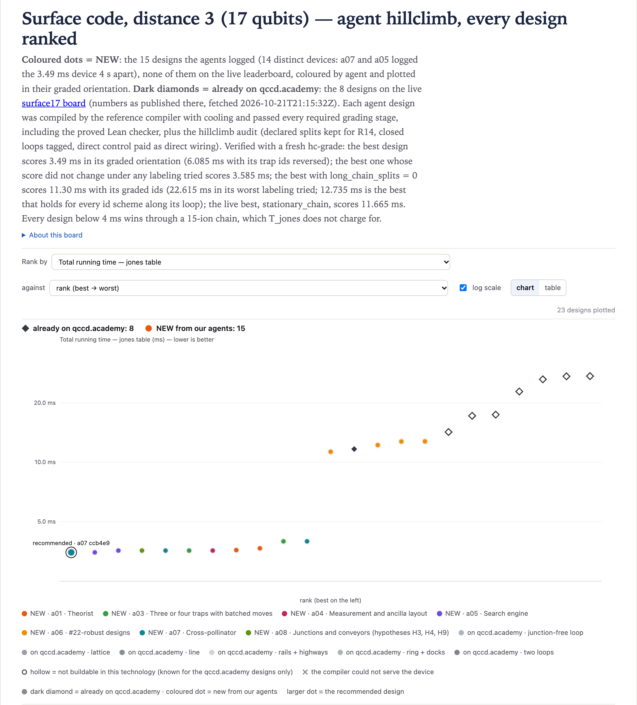

# surface17@1 · Surface code, distance 3 — 3.49 ms (v2)

**Best: 3.49 ms** in its graded orientation ([`01-a07-ccb4e9ed`](designs/01-a07-ccb4e9ed.arch.json)). The same
device with its trap ids reversed grades 6.085 ms. The best result whose score did not change under any labeling
tried is **3.585 ms** ([`08-a01-cbd1eaa8`](designs/08-a01-cbd1eaa8.arch.json)): 4 hc-grade variants and 17 hc-fast
relabelings all gave 3.585.
The best design with `long_chain_splits` = 0 is a 19-trap ring at **11.30 ms**
([`12-a06-5736ba8b`](designs/12-a06-5736ba8b.arch.json)), but only with its graded ids: the worst labeling tried
gives 22.615 ms. The best `long_chain_splits` = 0 result that holds for every id scheme along its loop is 12.735 ms.
The best live design, `stationary_chain`, grades 11.665 ms.

The search beat the low-motion seed it started from. That seed is a 2-trap path with capacities 3 and 15,
measured before the run: 4.375 ms, or 5.215 ms with its two trap ids swapped. Every path design here is below 4.375
in its graded orientation. In the worst labeling tried, three designs also stay below the seed's 5.215: a01's 3.585
and 3.66 ms devices, and the 15/2/1 path (worst 4.68). The 3.49 leader's worst labeling (6.085) does not. Every
design below 4 ms wins through a 15-ion chain, which `T_jones` does not charge for (see [Long chains](#long-chains)).

3.49 ms is one device logged twice: by a07 (`1792703579-a07-ccb4e9ed`) and, 4 s later, by a05
(`1792703583-a05-4c250a11`). The two files differ only in name, description and a note string, and compile to
the same program (`07f4a2b30d38d74a`). Only a07's is in `designs/`.

Eight agents searched for 2 hours (2026-10-22 20:45-22:45 UTC) and logged 15 designs. A separate verifier agent
then re-graded every design with a fresh hc-grade (all 10 stages). It also graded copies with mirrored positions
and reversed trap ids, and checked permuted trap ids with hc-fast, re-grading the extremes. Every logged score,
device digest and program digest reproduced, and all 15 designs are eligible and pass the audit. The toolchain is
QCCD's `compiler` branch at `84e8c5d`, qccdc `c774b87b677f` and qcheck `e8acd6640fd3`.
[`../README.md`](../README.md) gives the setup and the rules.

The chart shows the 15 designs logged in this run (coloured dots, by agent, each in its graded orientation; the
3.49 ms device is two dots) and the 8 live designs at their published numbers (dark diamonds), so `ring144_24v` and
`ring24_8` sit at 27.26 and 27.325 ms, not at their grades here (see
[Live designs graded here](#live-designs-graded-here)). A diamond is hollow where the page marks the design not
buildable.

## The designs

`designs/` holds 10 of the 14 physically distinct devices. The other four are only in [`results.csv`](results.csv):

- a08's and a07's 3.565 ms paths, which run the same program as `03`;
- a07's 3.97 ms path, which is `10` with rails of capacity 2;
- a06's 12.22 ms 19-trap ring.

*Worst* is the highest `T_jones` over the labelings the verifier tried: reversed ids, mirrored positions, 8 random
id permutations and every cyclic id shift. The highest of these were confirmed with hc-grade.

| file | T_jones (ms) | worst (ms) | long_chain_splits / moves | traps / junctions / DACs | idea |
|---|---:|---:|---:|---|---|
| [`01-a07-ccb4e9ed`](designs/01-a07-ccb4e9ed.arch.json) | **3.49** | 6.085 | 3 / 9 | 6 / 0 / 33 | path 1/1/1/15/1/2 (G/G/G/G/Mo/S): q8 and q12 wait alone, finished ions leave through an empty Mo trap |
| [`03-a05-2e36894d`](designs/03-a05-2e36894d.arch.json) | 3.565 | 5.97 | 3 / 7 | 5 / 0 / 120 | path 1/1/1/15/2 (G/G/G/G/S), direct control; the first design below 3.97 |
| [`06-a03-a1b85d43`](designs/06-a03-a1b85d43.arch.json) | 3.565 | 8.365 | 3 / 7 | 5 / 0 / 120 | path 3/1/1/15/2 (S/G/G/G/S): storage at both ends, same program as `03` |
| [`07-a04-ad9eb3a1`](designs/07-a04-ad9eb3a1.arch.json) | 3.565 | 5.97 | 3 / 7 | 5 / 0 / 33 | path 1/1/1/15/2 under shared control: the same program at 33 DACs |
| [`08-a01-cbd1eaa8`](designs/08-a01-cbd1eaa8.arch.json) | 3.585 | 3.585 | 3 / 14 | 10 / 0 / 33 | 10-trap path whose empty traps leave no id tie in the placement; 3.585 under every labeling tried |
| [`09-a01-cc2b6304`](designs/09-a01-cc2b6304.arch.json) | 3.66 | 3.66 | 3 / 10 | 6 / 0 / 33 | path 1/1/1/1/15/2 (S/G/G/Mo/G/S): an empty Mo trap before the big trap |
| [`10-a03-7ae724d4`](designs/10-a03-7ae724d4.arch.json) | 3.97 | 4.68 | 2 / 6 | 3 / 0 / 72 | path 15/2/1, all G, direct control: the best 3-trap path in the sweeps |
| [`12-a06-5736ba8b`](designs/12-a06-5736ba8b.arch.json) | 11.30 | 22.615 | 0 / 96 | 19 / 0 / 34 | closed ring, mixed zones, at most 2 ions per trap |
| [`14-a06-3c5a38e7`](designs/14-a06-3c5a38e7.arch.json) | 12.735 | 18.605 | 0 / 186 | 34 / 0 / 35 | ring of 17 G traps alternating with 17 empty S traps; 12.735 for every id scheme along the loop |
| [`15-a06-034186e3`](designs/15-a06-034186e3.arch.json) | 12.755 | 21.565 | 0 / 93 | 17 / 0 / 34 | ring of 17 identical capacity-2 gate traps; 12.755 for every id scheme along the loop |

`NN` in a file name is the design's rank in `results.csv`: verified `T_jones` in the graded orientation, with
ties broken by board time.

The design files are the board's graded documents with two keys changed. `name` is `hillclimb_surface17_<file
stem>`, and `description` is one sentence about the device. A script checked that every other key has the same JSON
value as in the graded file, and a text diff against it shows only the `name` and `description` lines. No file
had a `provenance` key.

`results.csv` lists all 15 board rows, then the 16 v1 PR designs re-graded under v2 (agent `v1:<agent>`).
`T_ms_worst_labeling` and `id_dependent` are the verifier's (`no` means every labeling tried gave the graded
score). The v1 rows were graded once, with their files' ids; that re-grade reports eligibility only, so `audit_ok`
and the worst labeling are blank, and `long_chain_splits` is filled only for the four v1 seeds measured before the
run. The `note` column holds the agents' own words. Where a note and a column disagree, the column is the graded value:

- the note of `1792703869-a06-c8fa3b49` says 18 traps, and the device has 19;
- the note of `1792706343-a06-3c5a38e7` says "id-robust", which holds only for id schemes along the loop.

## Why the best is fast

The 3.49 ms device is a straight path of six traps, T0..T5, with capacities 1/1/1/15/1/2 and rails of capacity 2.

- T0-T3 are gate traps (zone G), T4 is readout-only (Mo) and T5 is storage (S).
- It uses shared control (`simd_classes`, a broadcast channel map, `broadcast_groups` wiring) at 33 DACs. Under
  direct wiring, six traps would cost 144 DACs.

The schedule:

1. The placer starts q8 alone in T1, q12 alone in T2 and the other 15 ions in T3.
2. Layers 0-6 run with no motion, all in T3 except q12's first H (in T2). All 24 CX run in T3.
3. At layer 7, q0 has finished its gates. It leaves T3 for the empty T4 while q12 enters T3, then hops on to T5.
4. At layer 8, q1 follows the same way while q8 walks T1 → T2 → T3.
5. After its last CX, q8 walks back home to T1.

Only three MS instructions hold an ion that has moved: q12-q7, q12-q8 and q8-q14. Each gets one inserted cool. The
evicted ions, q0 and q1, have no gates left, so moving them costs transport but no cool. A move that leaves ions
behind pays a split and one that joins ions pays a merge (80 µs each, plus a 5 µs hop). Here every eviction goes
into an empty trap and every entry comes from a trap the ion has to itself, so no move pays both (165 µs): each
pays 85 µs, or 5 µs between two otherwise empty traps. In the 5-trap 3.565 ms path (`03`), which has no Mo trap, q1
is evicted straight into the storage trap that holds q0 and pays both, so its transport is 425 µs.

`cost_breakdown.qccdsim_jones.us_by_type` in the graded report, beside the 4.375 ms seed (from the brief, measured
before the run):

| | cool | gates | measure | transport (`simd`) | total |
|---|---:|---:|---:|---:|---:|
| 3.49 ms design, µs | 1200 (state-prep + 3 inserted) | 1220 | 720 (6 instructions) | 350 (9 moves in 6 instructions) | **3490** |
| 4.375 ms seed, µs | 1500 (state-prep + 4 inserted) | 1165 | 720 | 990 (6 moves at 165 µs) | 4375 |

- **Transport.** The six transport instructions take 85 + 5 + 85 + 85 + 85 + 5 µs. The last two are q8's walk
  home: 90 µs that a05, a03 and a07 found no device to remove.
- **Gates.** All 24 CX (45 µs each) and 8 H (20 µs each) run serially in T3, because R12 allows one gate per trap
  per instruction. The exception is q12's first H, which runs in T2 at the same time. That gives 1240 - 20 = 1220 µs.

Why q8 and q12 end up outside (from a01's, a05's and a07's reading of `place.ml`):

- The placer's spectral candidate fills traps in breadth-first order from the most central gate trap, following
  the Fiedler order of the CX graph: q12, q8, q7, q14, …, q1, q0, q11.
- q8 and q12 meet their partners last in the circuit, at layers 7-9.
- The empty end trap T0 makes T2 one of the two most central gate traps, together with T3.

## The floor

- **Cooling rule** (`qccd/compile/cooling.py`, from the brief).
  - `insert_cooling` replays the program as compiled, without the cools it inserts.
  - It puts a 300 µs global cool before every MS instruction in which some ion has n̄ > 1 (R7).
  - One split or merge adds 6 quanta. So an ion that has split or merged once gets a cool before *every* later MS
    instruction it is in, not only the next one.
  - One cool covers every pair in its instruction.
- **Fixed terms (measured).**
  - The state-prep cool is 300 µs. qccdc emits exactly one in every program (40 programs checked).
  - Measurement is at least 720 µs: 6 instructions. a04 read `compile.ml`: the router emits one measure instruction
    per ASAP layer that holds measurements, and the circuit has 6 such layers.
  - a04 compiled 45,356 eligible devices: 36,260 had 6 measure instructions, 8,451 had 7, 645 had 8, and none had
    fewer.
- **Three inserted cools for this family (sketch by a01, a03, a05 and a07; measured below).**
  - With q8 and q12 outside the 15-ion trap, the MS gates 12-7, 12-8 and 8-14 each hold a moved ion.
  - They are chained through shared qubits (12-7 then 12-8 on q12, 12-8 then 8-14 on q8), so they run in three
    different layers, and no two of them can be in one MS instruction. That is 900 µs.
  - Measured: a01 found no program with fewer than 3 inserted cools in about 42,000 devices.
  - a03's best per cool count, over about 40,000 hc-fast evaluations: 3.49 with 3 cools, 3.97 with 4, 4.33 with 5.
- **Floor of the family (sketch).** 300 + 900 + about 1220 + 720 + about 170-260 µs of transport gives about
  3.31-3.40 ms (a01, a03, a04, a05, a07). The 3.49 design is about 90 µs above it, which is q8's walk home.
- **Two cools (sketch, not reachable).**
  - a01 argues that every device needs at least 2 MS instructions with a hot ion.
  - Two cools need other ions than {q8, q12} outside the big trap. The agents name {q6, q16} (a01, a02, a03,
    a07, a08), {q0, q11} (a02, a03, a04, a05, a07), or q15 and q16 in separate traps (a05). a01's relaxation rules
    out {q0, q11}, and a02 measured 5 cools for it: both of its meetings fall in layer 2, before any ion in the
    15-ion trap has finished.
  - a07 and a08 forced {q6, q16} into a 2-slot trap beside the 15-ion trap with `--init-placement` (analysis only,
    never graded) and measured 3.43 ms with 2 cools. a01 forced q6 and q16 into two separate traps instead and got
    5.38-11 ms.
- **Why the placer never chooses {q6, q16}.**
  - It isolates only the ends of the Fiedler order: {q8, q12} or {q0, q11}.
  - The four 2-ion minimum cuts, {q0, q11}, {q8, q12}, {q2, q15} and {q6, q16}, tie in its objective, and ties go
    by qubit index (a02, a07, a08).
  - a08 checked this with a Python port of `place.ml`, which reproduces the compiler on 5 devices. Over all paths of
    3-6 traps, cycles, trees and 30k junction stars, it never isolates {q6, q16} with 14 or more ions in one trap.
- **Loose bound for any device (brief).** About 1.89 ms = 300 + 720 + 485 + 85 + 300 µs: the smallest of each term
  at once. No device has shown all of them together.

## Trap labels change the score

The compiler breaks ties by trap id: the placer's breadth-first fill, its choice of the most central trap, and
`meet()`, which gives a crossing CX to the lowest-id trap with room. So one physical device can grade differently
when its traps are renamed. This is a property of the compiler, not of the device. The verifier found that
mirroring positions (x → -x, ids kept) never changes the program: the ids cause the whole effect.

Take the 3.49 device. With the graded ids, T2 and T3 tie for most central, and T2 wins by id, so q12 and q8 go
outside. With the ids reversed, the 15-slot trap wins the tie, and q0 and q11 go outside instead. They must enter
at layers 1-2, before any ion has finished. That copy grades 6.085 ms: 2700 µs of cools, 1445 µs of transport, and
7 / 22 long-chain splits.

| design | graded | ids reversed | other labelings (verifier) |
|---|---:|---:|---|
| `01` (3.49, a07 = a05) | 3.49 | 6.085 | 5 cyclic shifts: 3.49 three times, 4.705 (rot3), 6.085 (rot4); 8 random: 3.49 five times, 6.085 three times |
| 3.565 family | 3.565 | 5.97-7.665 | worst: 5.97 (a04, a05, a07), 7.52 (a08), 8.365 (a03, a random permutation) |
| `08` (a01) | 3.585 | 3.585 | 3.585 in all 4 hc-grade variants and all 17 hc-fast relabelings |
| `09` (a01) | 3.66 | 3.66 | 3.66 in all 4 hc-grade variants and all 13 hc-fast relabelings |
| `10` and a07's 3.97 | 3.97 | 4.68 | 3.97-4.68 |
| `12` (11.30 ring) | 11.30 | 12.63 | 18 other origins along the loop: 12.615-19.675 (median 18.68); random: up to 22.615 |
| a06's 12.22 ring | 12.22 | 22.615 | 12.22-22.615 |
| `14` (34-ring) | 12.735 | 12.735 | all 34 origins along the loop 12.735; scrambled ids 12.635-18.605 |
| `15` (17-ring) | 12.755 | 12.755 | origins along the loop 12.755; scrambled ids 12.515-21.565 |
| 4.375 seed | 4.375 | 5.215 | — |

**Search methods.**

- No agent's NOTES shows a search over ids, names or file order (rule 6 of the brief). Every design uses a fixed
  `T0..Tn` scheme along its path or loop. a05 logs each path in the orientation a fixed rule picks (the
  lexicographically smallest capacities, zones and rails), which does not look at `T`.
- A search over capacity and zone sequences still tries both orientations of each path, and every origin of a
  ring with mixed traps. It therefore picks the lucky tie-break without trying to (#20 residue). This is why every
  number above is reported with its worst labeling.
- The robust designs avoid the tie by geometry. In `08` and `09`, the empty traps leave exactly one most central
  gate trap and keep q8's trap ahead of the big trap in the breadth-first order.
- That costs transport. In `08`, q12 walks 2 hops and q8 3, so it pays 445 µs against 350 (95 µs more); `09`
  pays 520 (170 µs more).

## #22 exposure

- **What R14 judges today.** R14 fails only moves whose class *declares* `split`. Splits derived from chains are
  charged but not judged (#22). Every design here has `declared_splits` = 0.
- **What `long_chain_splits` counts.** hc-chainsplits counts the moves that leave ions behind at a site that held
  more than 2 ions. These are the moves R14 would judge if #22 were fixed.

| design | long_chain_splits / moves |
|---|---:|
| 3.49 (`01`) | 3 / 9: q0 and q1 are evicted from the 15-ion trap, and q8 leaves it to walk home |
| 3.565 family | 3 / 7 |
| 3.585 (`08`), 3.66 (`09`) | 3 / 14, 3 / 10 |
| 15/2/1 path (`10`) | 2 / 6 |
| a06's rings `12`, `14`, `15` and the 12.22 ms ring | 0 / 96, 0 / 186, 0 / 93, 0 / 89 |
| 4.375 seed | 6 / 6 |
| live `stationary_chain` | 32 / 32 |
| live `deck_unit_cell` | 0 / 54 |
| v1 06-a09, 10-a05, 16-a05, 26-a12 | 27 / 34, 25 / 27, 30 / 31, 35 / 36 |

- **No 15-ion-trap design can reach 0 (proof sketch by a05 and a07).**
  - 17 ions do not fit in one 15-slot trap, and the CX graph is connected, so some ion must cross into the full trap.
  - The free slot it needs opens only when an ion leaves the 15-ion chain, and that is a long-chain split.
- **Searches for lcs 0 among small devices found none.**
  - a06: 1,250 random and mutated paths of 2-7 traps.
  - a02: none of the 9,679 devices it re-checked with T < 14.2 ms.
  - a03: in 3,100 devices, the lowest was 2.
- **The lcs 0 designs logged here are rings.** a06 argues (sketch) that any lcs 0 design under this router keeps at most 2
  ions at each site an ion leaves. That needs at least 9 traps, so shared or wise control, with R22 on.
- **If #22 is fixed** as hc-chainsplits assumes, every design here below 11 ms has 2-3 long-chain splits, and
  every v1 design checked has 25-35. The best result left would be the 11.30 ms ring with its graded ids, or
  12.735 ms for any id scheme along the loop. `stationary_chain` (32 / 32) would be affected too. The best live
  lcs 0 design is `deck_unit_cell` at 14.23 ms.

## Long chains

`T_jones` charges an MS instruction 25 µs whatever the chain length. The only limit is R13: at most 15 ions in a
trap at a gate, which is also the most slots qccdc offers per trap. All the leaders use it fully:

- **The paths with one 15-slot trap and 1-slot satellites** (`01`-`09`): 15 ions sit in that trap from the start,
  and all 24 CX run there.
- **The 15/2/1 path** (`10`): 15 ions sit in T0, and 21 of its 24 CX run there.
- **The seed:** 14 ions in its 15-slot trap.
- **The rings** (`12`, `14`, `15`): one ion per gate trap at the start and never more than 2 per trap. They pay
  for it in motion: 59-122 transport instructions, and a cool before each of their 9 MS instructions.

Every agent whose best is a path design says in its REPORT that it wins through the long chain. Whether such
devices should count as `T_jones` results, or whether a chain-length cost will come, was asked on #10 on
2026-10-21.

## What did not work

hc-fast, unless graded; the numbers are the best in each family.

- **2-trap paths** (exhaustive over capacity, zone type and rail capacity; a02 2,835 devices, a05 3,780): nothing
  beats the 4.375 seed.
- **3- and 4-trap paths.**
  - 3-trap paths: 3.97 (15/2/1; a03's sweep of 2,815, a05's of 7,100).
  - 4-trap paths with all traps G: 4.835 (a03, a05, a07).
  - 4-trap satellites (1/1/15/2): 4.06 (a01, a04, a05, a07).
- **Spare gate room next to the big trap.** The compiler moves ions into any free gate slot for 1q gates and
  meetings, and those ions then pay cools: 15/3 5.215, 2/15/1 5.745, 15/4 7.435, 15/5 and up about 10.5 (a02, a05,
  a07).
- **Two gate traps in parallel.**
  - Two medium or large gate traps: 5.23 (a04, 5,000 devices).
  - Two big traps summing to 17-19: 3.97 (a03).
  - Far meeting rooms (15/1/1/1/5/3): 5.155 (a05). Gates drop to 1075 µs, but transport rises to 2040 µs and
    measurement to 840 µs.
- **Symmetric paths.** A palindromic path reads the same from either end, so reversing its ids changes nothing,
  but the best is 5.685 (a02, a05): the centre lands on the big trap, which puts q0 and q11 outside.
- **Cycles and rings.**
  - Cycles of 3, 4 and 5 traps: 4.35, 5.375 and 6.77 (a05).
  - Rings with satellites and storage: 3.77-3.965 (a03, a04, a07, a08).
  - Rings of 18-34 identical traps: 18.1-23.9 (a06).
- **Junctions.**
  - 3-arm junction stars: 6.51 over 758 capacity triples (a08).
  - A junction on the storage side of the leader: 3.775 instead of 3.49 (a08).
- **Other topologies.**
  - Docked conveyors `ring(w,2,v)`: 21.39, the starter itself (a08).
  - Grids: 14.3 (4x4) and 14.445 (3x4), both lcs 0 (a06).
  - Multi-loop rings: 11.52-11.555 at their search ids, but 18.355-29.575 with the ids reversed (a06). Not logged.
- **Removing q8's walk home** (90 µs): no agent found a device that does it. Every way a03 found to block the
  walk also blocked q8's way in; a07's variants failed to compile or still walked home (a03, a05, a07).

## Exploit review

The verifier found no scoring exploit:

- **No placement or edited program.** Fresh compiles reproduce every logged program digest with no placement
  passed, so no counted result uses `--init-placement` or an edited program. The forced placements a01, a07 and a08
  describe were analysis-only probes and are not on the board.
- **Id, name and order search.**
  - None of the NOTES files shows one.
  - A search over capacity and zone sequences still selects the lucky tie-break implicitly (#20 residue).
  - Each id-dependent number is therefore reported with its worst labeling.
- **The empty end trap T0 in the 3.49/3.565 family (flagged by a05; a04 describes the same effect).**
  - It only moves the placer's most central seed.
  - It is a real extra trap (no DAC cost under shared control, 24 DACs under direct) and changes no grader rule,
    so it counts as a device change.
  - It is still a placer steer that depends on ids.
- **Eviction of the lowest-index idle ion** (q0, q1). This is luck in the circuit's qubit numbering, not a grader
  exploit. Counted.
- **Rule checks.** All 15 designs and all 60 graded variants pass:
  - `declared_splits` is 0;
  - the classes are `x_junction_grid` plus `shuttle` only;
  - every ring rail is tagged `L0`;
  - direct control pays 24 DACs per trap, and shared control is 33-35 DACs with R22 passing;
  - R13 holds at exactly 15;
  - there are no zero-length hops;
  - no board digest matches a live design.
- **Process note.** a02's note about a `pkill -u hcagent -f` pattern is process hygiene, not a scoring exploit, and
  no result depends on it.

## Live designs graded here

The board's page was fetched at 2026-10-21 21:15 UTC; its numbers were regenerated under the new physics. Each
design was rebuilt and graded here with hc-grade. `long_chain_splits` / moves and DACs are as measured before the
run.

| live design | on qccd.academy | graded here | eligible / audit_ok | long_chain_splits / moves | DACs | rebuilt from |
|---|---:|---:|:---:|---:|---:|---|
| `stationary_chain` (answer) | 11.665 | 11.665 | yes / yes | 32 / 32 | 48 | `arch/stationary_chain.arch.json` |
| `deck_unit_cell` | 14.23 | 14.23 | yes / yes | 0 / 54 | 44 | `arch/deck_unit_cell.arch.json` |
| `cyclone_base` | 17.19 | 17.19 | yes / yes | 15 / 147 | 38 | `arch/cyclone_base.arch.json` |
| `ladder_2x72` | 17.43 | 17.43 | yes / yes | 0 / 98 | 56 | `arch/ladder_2x72.arch.json` |
| `cyclone_dual_loop` | 22.835 | 22.835 | yes / yes | 0 / 346 | 44 | `arch/cyclone_dual_loop.arch.json` |
| `h2_racetrack` | 26.325 | 26.325 | yes / yes | 0 / 290 | 72 | `arch/h2_racetrack.arch.json` |
| `ring144_24v` | 27.26 | **37.69** | yes / yes | 0 / 3108 | 46 | `arch/ring144_24v.arch.json` |
| `ring24_8` | 27.325 | **26.94** | yes / yes | 0 / 687 | 35 | `Machine.ring(12, 2, 8)` (guess) |

Two rows differ, `ring144_24v` and `ring24_8`. Every row on the page is a replay (`T_source: replay`), and for these
two the page's program is not the one hc-grade compiles. The page counts 556 and 197 instructions, while
hc-grade's programs have 236 each. On the other six rows the page counts one instruction more than hc-grade.

## The first round (v1)

v1 reported 1.585 ms against 2.045 ms for `stationary_chain`, from nine 5-trap devices whose moves paid no split
or merge at the time. Since upstream #15-#21, a move that leaves or joins a chain pays its split or merge (80 µs
each) and makes the moved ion pay a 300 µs cool before each later MS instruction it is in, so the 16 v1 files now
grade 6.545-12.31 ms or fail R20/R21 (`04-a02`), and `stationary_chain` itself grades 11.665 ms. Their v2 grades
are the `v1:` rows of [`results.csv`](results.csv), and the v1 files are in this PR's history.
