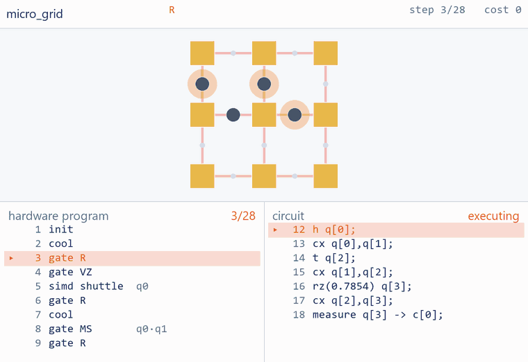
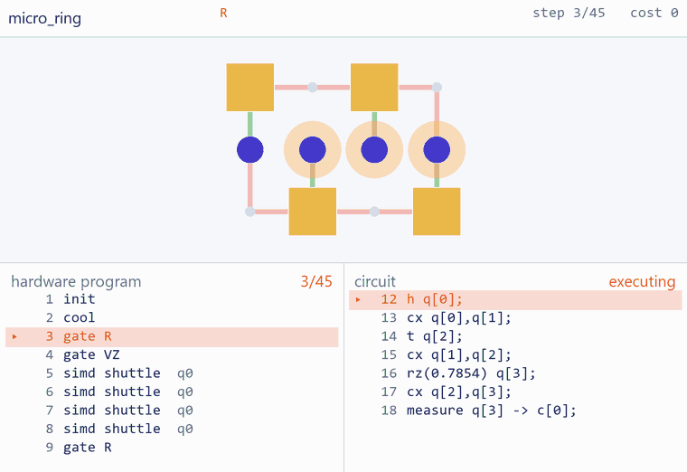

# `Compiler/` — QASM in, hardware instructions out

A verified compiler from OpenQASM to TSIR, the hardware instruction format the rest of this
repository already replays, rule-checks and prices.

**Read [`PLAN.md`](PLAN.md) first.** It states what is being built, why the trust architecture is
shaped the way it is, and what each milestone has to prove.

The one-sentence version: `qccd/verify` reported 27 of its 28 rules on any program and skipped
**R10 — "the compiled program implements the input circuit"** — because there was no QASM front end
to check against. This directory is the front end, and **R10 now reports `passed`**, decided in
two halves: a checker written in Lean and proved sound there (`QCCDC.Cert.check_sound`, axioms:
`propext` only) that the program follows its certificate — mapping, transport, co-location of
each op's own ions, order — and a comparison of the emitted pulses with the source circuit,
computed rather than proved, which is the half that sees which gate fires.

## Status

### Checked compilation stages

Studio's Compile and Run actions now run the following named stages. Each boundary saves
its input, output, witness, checker method, coverage and verdict. Optimizers choose
candidates; the checkers accept or reject those candidates independently.

| Stage | Single obligation |
|---|---|
| 1. Circuit Normalization | Preserve the source circuit while lowering composite gates and retaining source-operation identities. |
| 2. Dependency Analysis | Reconstruct quantum/classical wire order, reset dependencies and barrier fences. |
| 3. Initial Placement | Establish a complete legal qubit-to-ion mapping and occupancy. |
| 4. Interaction Placement | Assign ordered gate operands to capable sites with enough capacity. |
| 5. Transport Synthesis | Replay physical paths or collective shifts and check identity, arrival and movement constraints. |
| 6. Native Gate Lowering | Check each native pulse sequence against its logical operation, including angles and virtual-Z frames. |
| 7. Broadcast Packing | Preserve each ion's ordered pulse sequence when grouping commands. Full hardware control rules are also checked at final acceptance. |
| 8. Operating-Point Binding | Recompute durations, intrinsic heating and resources from the fixed device and physical model. |
| 9. Event Scheduling | Assign and check actual execution intervals. |
| 10. Thermal Analysis | Integrate elapsed-time and intrinsic heating and check gate-entry budgets and the declared cooling policy. |
| 11. Cooling Insertion | Insert legal cooling while preserving every original operation; invalidate and repeat stages 8–10. |
| 12. Artifact Validation | Reload the executable and check source semantics, certificate binding, enforceable hardware rules and physical annotations. |

Stages 4–7 repeat over execution frontiers. Cooling is conditional and its repair
loop is bounded. The first timing backend is serial between instructions and
preserves SIMD within each instruction. Cross-instruction overlap is rejected by
this backend; supporting it requires a checker for concurrent thermal execution.
Classically conditioned QASM is currently rejected because the native backend
does not yet implement its conditional execution.

The native compiler writes `<prefix>.stages.json`. Its standalone checker reruns
the saved stage checks against the source, device and native executable:

```bash
Compiler/ocaml/_build/default/bin/qccdc_cli.exe check-stages build/prog.stages.json \
  --qasm circuit.qasm --arch build/device.expanded.json --program build/prog.tsir.json
```

A C2LR lattice is compiled by the C2LR router instead (`qccd.compile.c2lr_router`), whose stage
file names the engine `c2lr-router`. Its swap-or-stay steps name no routes, so `check-stages`
cannot replay them: `Compiler/bridge/check_c2lr_stages.py` re-checks those stages, and the
driver picks the checker by engine (docs/c2lr.md, section 6d).

After the usual architecture export and native compilation, run the remaining
stages and final acceptance with:

```bash
python Compiler/bridge/finish_staged.py build/prog --qasm circuit.qasm \
  --arch device.arch.json --expanded-arch build/device.expanded.json
```

The second command saves the original native program as `.native.tsir.json`, the
timed executable as `.cooled.tsir.json`, and a certified correspondence baseline
as `.tsir.json`. The baseline retains the checked final annotations on the original
operations, so existing evaluation still compares instruction bodies exactly.
Use `.native.tsir.json` when rechecking native evidence after finalization.
`.compilation.json` records acceptance or rejection; `.evidence/manifest.json`
links immutable content-addressed snapshots and retains invalidated retry history.
Studio also stores the evidence objects and manifest in its artifact store.
Submission reuse requires this complete stored chain, with the executable,
certified baseline and certificate matching the final checked boundary. Older
cached runs without stage evidence are recompiled.

These are executable checks under the declared model. Stage hashes establish
integrity, not semantics. Native unitary checks are numerical; the existing Lean
checker retains its transport/mapping certificate scope. A partial source-semantic
check cannot be promoted by an exit-zero process result. Experimental calibration,
R7b duty-cycle budgets and the missing R15 interference model remain outside the
acceptance claim. The separate BB/ring research pipeline remains a separate entry
point; the workflow above is the native compiler used by Studio.

| milestone | state |
|---|---|
| **C0** interface: OCaml ⇄ Python JSON, validated against the 397 184 / 8 808 oracle | ✅ done |
| **C1** QASM front end + DAG, 507/507 vs `circuit_to_dag` | ✅ done |
| **C2** native gate set + Lean pulse theorems (6 theorems, no `sorry`) | ✅ done |
| **C3** place + route + aggregate → end-to-end compile, R10 `partial` | ✅ done |
| **C4** SAT routing + optimality oracle | ✅ done |
| **C5** placement relaxation + the (runtime, error) frontier | ✅ done |
| **C6** Lean verified checker; with the tableau check, **R10 `passed`** | ✅ done |
| **C7** oracle reproduction — rigid rotation; BB[[144,12,12]] compiles and passes R10 (§11.9) | ◐ partial |

C7 is ◐ because Cyclone's external oracle is still unattempted, not because the ring is.
`qccdc rotate` compiles BB[[144,12,12]] on `ring144_24v` — which the general router cannot
route at all, it stops at 46% loop occupancy — in 776 hops against the shipped Python
pipeline's 2 672, with all 20 checkable rules and R10 `passed`:

### Watching one run



The same seven statements on the same twelve traps, wired as a loop rather than a lattice:



| same circuit, same trap count | `micro_grid` | `micro_ring` |
|---|---:|---:|
| traps / junctions | 12 / 5 | 12 / 4 |
| hardware instructions | **28** | 45 |
| transport instructions | **5** | 22 |
| ion-hops | **5** | 22 |
| cost | **15** | 33 |
| machine steps | **32** | 44 |
| runtime | **2.045 ms** | 2.615 ms |
| all 20 checkable rules | pass | pass |
| R10 (proved Lean checker + tableau) | **passed** | **passed** |

The grid runs it **1.28x faster on the same number of traps**, and the reason is one row: a
lattice gates where the ions already are; a ring has four gate zones and has to carry every
pair to one. That trade is what the ring buys elsewhere -- it is the shape that lets rigid
rotation move 168 ions with one instruction.

Two listings sit under the stage and the clip steps both: the **hardware program** on the
left, indexed by machine step, and the **circuit** on the right, indexed by source line.
Neither moves -- only the cursor does, and its colour says which of two things is happening.
Orange is the gate firing; teal is the machine still travelling towards the statement, or
clearing up after it.

One command builds both devices, compiles `examples/micro.qasm` to each, verifies
them, renders the clips and prints the comparison:

```bash
python bridge/micro_demo.py --gif
```

`--qasm` gives the animated page a second listing -- the circuit -- and steps it with the
hardware. The statement the executing instruction is discharging is lit; the statements a
shuttle is travelling towards are shaded; clicking a statement jumps to the instruction
that discharges it. `python -m qccd studio --tsir ... --qasm ...` opens the same thing
inside the design tool.

```bash
python bridge/render.py build/out/steane.cooled.tsir.json \
    --arch arch/grid9x9.arch.json --qasm examples/steane_esm.qasm \
    -o ../out/compiled/steane_debug.html
#   circuit: 36 statements, 55 instructions discharge one and 21 shuttle towards one
```

The join is *checked*, not asserted. Every instruction carries `meta.op` -- the circuit
operations it serves, stamped as the compiler emitted it -- because the certificate's gate
witnesses are far too sparse to drive a page (10 of 50 gate instructions on
`steane_esm/grid9x9`; 690 of 3,018 on the BB rotation schedule). Those sparse witnesses
are then used to *verify* the dense stamps: if any witness disagrees with the stamp on the
instruction it names, `qccd.ir.source_map` raises and nothing is drawn. Building it that
way immediately found that a witness's `instr` field had always named the last instruction
of the whole layer rather than one that performs the operation -- harmless while nothing
read it, wrong the moment something did.

`compile` reaches it on its own -- rotation is tried only after the general router
declines, so it can add programs that compile but never change one that already did:

```bash
cd Compiler
ocaml/_build/default/bin/qccdc_cli.exe compile build/bb144_esm.qasm \
    --arch build/ring144_24v.expanded.json -o build/out/bb144_rot
python bridge/mk_qcheck_input.py build/out/bb144_rot \
    --arch build/ring144_24v.expanded.json -o build/qc_bb144.json
python bridge/check_cert.py build/out/bb144_rot --qasm build/bb144_esm.qasm \
    --arch arch/ring144_24v.arch.json --qcheck build/qc_bb144.json   # under a second in Lean
```

---

## R10, the rule that was always skipped

Of the [28 rules](../docs/rules.md), twenty-seven are structural and the platform has always
checked them. R10 — *"the compiled program implements the input circuit"* — had only ever
been reported **skipped**, never `passed`. Run the verifier on anything and it says so
itself, and says why:

```console
skipped R10: needs symbolic permutation + Pauli-frame tracking against a QASM DAG
```

It is now checked, in two halves.

**Transport and ordering.** `QCCDC.Cert.check` is defined as `decide (Implements inp)`,
where `Implements` is a *proposition* saying what it means for the program to follow its
certificate: each witness naming exactly the ions its op's qubits are mapped to, in any
order, and the replay having them together at a trap that can gate; every move a hop the
**architecture** admits; every op witnessed exactly once; dependent ops in program order.
Soundness is then `of_decide_eq_true`, so all the content sits in a statement a reader can
judge rather than in a pile of `Bool`s with a meaning asserted elsewhere. Eleven further
theorems prove each named way of being wrong is one `check` *cannot* accept — a dropped
gate, a teleport, an aliased qubit, a witness naming two other ions that happen to stand
together, a reordering — and [`bridge/mutate_cert.py`](bridge/mutate_cert.py) seeds twelve
such defects into real compiled certificates to confirm the checker rejects them in
practice too. None of them is a wrong gate: a witness names an op, a cycle, a trap and
ions, never a gate, so a two-qubit `barrier` compiled as a CX passes this half — compilers
up to `c7c535380bfb` did exactly that — and only the semantic half refuses it.

**Semantics.** The pulses are read out of the emitted program and composed back into a
stabilizer tableau — or, for small non-Clifford circuits, an exact unitary — and compared
with the source circuit's own, built from the QASM. This reads the emitted program, not the
compiler's claims about it, and it is the half that says which gate fires. It is computed,
not proved.

The facts the checker judges against — which traps can gate, which pairs are one cycle
apart, the cyclic order of each loop — are re-derived from the architecture document by code
the compiler never runs. **A compiler cannot widen the machine by asserting it.**

## What it compiles

Nine example circuits × the nine reference architectures:

```console
$ python bridge/run_matrix.py
81 (circuit, architecture) pairs
   72 fully verified   -- compiled, all rules pass, R10 passed
    9 out of reach     -- device too small, or the heuristic router declined
    0 DEFECTS          -- a rule violated or R10 refused
```

The nine out of reach are honest failures, not silent ones: `stationary_chain` has two
traps, and the router declines rather than emitting something illegal.

### `BB [[144,12,12]]` on `ring144_24v`

The case worth naming, because it needed a second router. Moving ions one at a time runs out
at **46.2% loop occupancy** — past half full on a ring, a path across the device is a traffic
jam no amount of replanning clears — and the round needs 53.8%. Rigid rotation has no such
limit: one `loop_shift` template advances *every* ion at once, so occupancy never changes.

| ESM round | general router | rigid rotation | shipped Python pipeline |
|---|---|---:|---:|
| hops | *unroutable* | **776** | 2,672 |
| batches | — | 546 | **396** |

Fewer hops, more cycles — a different trade, not a free win. All applicable rules pass and
R10 is `passed`: the proved checker accepts the 1,008-witness certificate in under a second,
and the tableau composed from the emitted pulses matches the circuit's.

`compile` tries the general router first and rotation only once it has declined, so it can
add programs that compile but never change one that already did. `--no-rotate` refuses the
fallback, which is what [`bridge/c7_occupancy.py`](bridge/c7_occupancy.py) needs in order to
measure the individual-ion router rather than the pair of them.

The last fallback, after the race track, is **split rounds** (`Compile.run_split`, 2026-10-21).
Two surface-5 patches side by side put 98 ions and about 50 movers per CNOT layer on grid9x9.
Prioritised planning parks the first ions it routes, and they wall in the last, so every
placement and trap order was refused on every shipped device. Split rounds change three things:

* a round that cannot be routed runs again with half its gates; the rest wait for the next
  round, as a gate with no free trap already does;
* an operand walled off from its meeting trap by full traps has one idle ion moved out of each
  full trap on its path;
* the router's tolerant last rung is off, so a plan the verifier would reject is split again
  rather than emitted.

A round holds only gates on disjoint qubits, so each qubit keeps its gate order. Results:

* the 98-ion circuit compiles on grid9x9, deck_unit_cell and cyclone_base;
* every rule passes, and R10 passes with the proved checker on grid9x9;
* outputs the general router, rotation or the race track produced before are byte-identical.

#### The schedule is decided upstream; the compiler certifies it

546 batches is what rigid rotation does with a layout it chose by stride and a binding the
QASM fixed round-robin. Neither knows it is compiling a code. `qccd/compile` does — it
places the six members of every check close together and packs 144 check-arcs onto the
docks — and reaches **55 batches** on the same device, but emits no certificate. The bridge
is [`Codesign/scripts/bb_schedule.py`](../Codesign/scripts/bb_schedule.py): it runs the
code-aware placer and binder, writes the binding and contact order into the QASM
(`gen_bb144.py --schedule`) and the layout into a file `qccdc rotate --placement` reads, so
the *same* rotation pass — same DAG rule, same readiness rule, same certificate, same proved
checker — compiles the code-aware schedule:

```bash
python Codesign/scripts/bb_schedule.py --arch arch/ring144_24v.arch.json --ancillas 24 \
    -o build/q06/ring24                         # .schedule.json + .placement.json
python bridge/gen_bb144.py -o build/q06/bb.qasm --schedule build/q06/ring24.schedule.json \
    --steady-state                              # a reset before every check
python Codesign/scripts/esm_check.py build/q06/bb.qasm   # measures exactly the stabilizers?
ocaml/_build/default/bin/qccdc_cli.exe rotate build/q06/bb.qasm \
    --arch build/ring144_24v.expanded.json --placement build/q06/ring24.placement.json \
    -o build/q06/bb_sched
```

| `bb144_esm` on `ring144_24v`, 24 ancillas | stride layout, round-robin | code-aware schedule via `--placement` |
|---|---:|---:|
| batches / rotate hops | 546 / 776 | **55 / 253** |
| round time, corrected model, cooled, steady-state resets | 520.4 ms | **69.8 ms** |
| 20 rules · R10 by the proved checker | passed · passed | passed · passed |

A placement can only change how many batches the round takes, never whether the program
is right: `--placement` is checked (every docked qubit names a dock that exists, every
rider a slot, nothing named twice) and everything downstream is untouched. What R10 does
*not* check is whether the QASM is a correct syndrome-extraction circuit — a scheduler
that interleaves X and Z checks freely can emit one that measures the wrong operators,
and three of four packings tried did. `esm_check.py` tests that in stim, upstream of R10;
`bb_schedule.py --phases xz` (the default) finishes every X check before the first Z
contact, which makes it true by construction. See
[`Codesign/findings/q06`](../Codesign/findings/q06-compiler-axis.md).

Two of those results are ones the checker found rather than testing: the first rotation
compiler emitted the ancilla Hadamards as pulses but never *witnessed* them (invisible to a
tableau, which composes from what was emitted), and its scheduler reordered commuting `cx`
gates, which the order rule rejected outright. For a while the checker admitted that second
reordering through a proved exemption — [`Cert/Commute.lean`](lean/QCCDC/Cert/Commute.lean)
proves two `cx` gates commute when they share a control with distinct targets, or a target
with distinct controls. Since 2026-10-19 it does not: the order of a qubit's gates is the
circuit author's, not the compiler's (a syndrome round's CNOT order is chosen on purpose), and
a reorder of commuting gates is invisible to the tableau, so the order rule is the only place
to catch it. The scheduler now keeps each qubit's order, and both the order rule and
`check_cert.py` reject a reorder, commuting or not.

## Build and run

`qccd toolchain install` fetches a prebuilt `qccdc_cli` (Windows and Linux on x86-64, macOS on
Apple silicon) and, where one is published, `qcheck`. Only the gates below need the toolchains
themselves; all three are pinned.

```bash
# OCaml 5.3.0 / dune 3.19+ / yojson 2.2.2.  macOS: `brew install opam`; then everywhere
#   opam init && opam switch create 5.3.0 && opam install dune yojson.2.2.2
# ocamlenv.sh activates the switch (on Windows, where `ocaml` is NOT on PATH by default,
# the opam `default` one; elsewhere $QCCD_OPAM_SWITCH or opam's current one)
cd Compiler && source ./ocamlenv.sh && (cd ocaml && dune build)   # the binary is qccdc_cli.exe on every OS

# the proved checker alone, without Mathlib: about a minute on a fresh machine, most of it
# elan fetching the pinned Lean (macOS: `brew install elan-init`)
cd Compiler/lean/checker && lake build                     # .lake/build/bin/qcheck

# the C0 gate: expand every architecture, export every fixture, round-trip them all,
# and replay the result against the oracle
bash Compiler/run_c0.sh

# the C1 gate: generate 507 circuits, parse with both front ends, compare, then
# prove the comparator can fail by mutating our side seven ways
bash Compiler/run_c1.sh

# the C2 gate: derive the pulse identities, prove them in Lean, check the OCaml
# table against the defining unitaries, decompose the whole corpus
bash Compiler/run_c2.sh

# the C3 gate: compile 4 circuits onto 6 architectures, insert cooling, check all
# 28 rules, and decide R10: the proved checker holds the program to its
# certificate, and the tableau composes its pulses back into the circuit
bash Compiler/run_c3.sh

# the C4 oracle: re-solve the router's own sub-problems exactly, and price the
# broadcast constraint by solving each one twice
bash Compiler/run_c4.sh

# the C5 sweep: which placement relaxation actually wins, and the
# (runtime, gate error) frontier traced by the cooling budget
bash Compiler/run_c5.sh

# the C6 gate: build the proved Lean checker, run it on every compiled program,
# and seed 11 defects it has to reject
bash Compiler/run_c6.sh

# or all of it, plus the verification matrix
bash Compiler/run_all.sh
```

Lean is pinned to `leanprover/lean4:v4.29.0-rc2` with Mathlib rev `3542f17d`, matching the
**prebuilt** cache in `LeanQEC/.lake/packages` (7,676 `.olean`). Do not bump either without
intending a multi-hour rebuild. Only the pulse proofs (`QCCDC/Pulse`, the C2 gate) need
Mathlib; `qcheck` imports Lean core alone, which is why `lean/checker` can build it without
cloning Mathlib at all.

## Layout

| | |
|---|---|
| [`PLAN.md`](PLAN.md) | the design: trust architecture, SAT encoding, milestones |
| [`ocaml/lib/tsir.ml`](ocaml/lib/tsir.ml) | TSIR reader/writer — a faithful mirror of `qccd/ir/tsir.py` |
| [`ocaml/lib/arch.ml`](ocaml/lib/arch.ml) | the expanded architecture, and the routing-regime classifier |
| [`ocaml/lib/qasm.ml`](ocaml/lib/qasm.ml) | OpenQASM 2.0 lexer and recursive-descent parser |
| [`ocaml/lib/circuit.ml`](ocaml/lib/circuit.ml) | register flattening, broadcast, and the dependency DAG |
| [`ocaml/lib/gateset.ml`](ocaml/lib/gateset.ml) | the native gate set — the two Lean theorems, as code |
| [`ocaml/lib/gateset_composites.ml`](ocaml/lib/gateset_composites.ml) | composite gates, custom-gate inlining, and the n-qubit self-test |
| [`lean/QCCDC/Pulse/`](lean/QCCDC/Pulse/) | `Native.lean`, `Decompose.lean` — obligation O2 |
| [`ocaml/lib/traps.ml`](ocaml/lib/traps.ml) | the trap graph: what one machine cycle can move an ion between |
| [`ocaml/lib/place.ml`](ocaml/lib/place.ml) | placement — greedy weighted insertion |
| [`ocaml/lib/route.ml`](ocaml/lib/route.ml) | the router: prioritised space-time A*, with the rules as its reservation table |
| [`ocaml/lib/compile.ml`](ocaml/lib/compile.ml) | the pipeline, and TSIR emission |
| [`ocaml/lib/cert.ml`](ocaml/lib/cert.ml) | the certificate: where and when each statement runs, which the proved checker holds the program to |
| [`lean/QCCDC/Cert/`](lean/QCCDC/Cert/) | `Check.lean` (the specification), `Sound.lean` (proved), `qcheck` (compiled) |
| [`bridge/mutate_cert.py`](bridge/mutate_cert.py) | 12 seeded defects the checker has to reject |
| [`bench/`](bench/) | the C1 corpus: 7 named circuits + 500 seeded random ones |
| [`ocaml/bin/qccdc_cli.ml`](ocaml/bin/qccdc_cli.ml) | `qccdc` — the CLI |
| [`bridge/`](bridge/) | Python side of the interface: export, replay, diff |
| [`solver/route_sat.py`](solver/route_sat.py) | the untrusted SAT oracle, and the independent legality re-check |
| [`bridge/c4_gap.py`](bridge/c4_gap.py) | the optimality gap and the price of broadcast control |
| [`run_c0.sh`](run_c0.sh) | the C0 acceptance gate |

## What C4 measured

One waveform per named loop is what makes this hardware different from ordinary
multi-agent pathfinding. Solving each of the router's own sub-problems twice — once with
that constraint, once without — prices it:

```
clifford12 / grid9x9       direct-wired   0 cycles   binds on 0/8   <- the control
clifford12 / cyclone_base  broadcast      5 of 29    binds on 4/8   (17%)
qft6       / h2_racetrack  broadcast      9 of 37    binds on 8/8   (24%)
```

The heuristic router is optimal on every instance of the first two; on the racetrack the
oracle found two instances at 43 and 39 cycles where 5 suffice, and fixing one of them
halved the aggregate gap. See [`PLAN.md`](PLAN.md) §11.6.

## The verification matrix

`python Compiler/bridge/run_matrix.py` — 9 examples (GHZ, QFT, Bernstein-Vazirani, a
ripple-carry adder, Steane and surface-17 syndrome extraction, a repetition round) on all
9 shipped architectures:

```
81 (circuit, architecture) pairs
  53 fully verified   -- compiled, all rules pass, R10 passed
  16 partial          -- legal, R10 not fully established (non-Clifford)
  12 out of reach     -- device too small, or the heuristic router declined
   0 DEFECTS
```

## What C5 measured

Cooling frequency is a continuous exchange rate between time and accuracy. Sweeping the R7
budget on `clifford12`/`grid9x9` traces it:

```
budget  64 -> 18.21 ms, gate error 3.8486,  1 cool
budget  16 -> 31.11 ms, gate error 0.4420, 46 cools
budget   1 -> 39.81 ms, gate error 0.1711, 75 cools
```

**2.19× in runtime for 22.5× in error.** The three shipped policies (`fastest`, `coolest`,
`balanced`) all land at the slow, accurate end — not dominated, but not a *choice* either.

Spectral placement was predicted to beat greedy insertion and **lost on every instance**;
the hill-climb on the true objective won instead (up to 12%). See [`PLAN.md`](PLAN.md) §11.7.

## The interface

JSON on disk is the *only* coupling between the three languages. Nothing is shared but documents,
so every stage is independently runnable and independently diffable.

```
python bridge/export_arch.py arch/ring144_24v.arch.json -o build/ring144_24v.expanded.json
python bridge/export_deck.py -o build/deck24.tsir.json

cd ocaml && dune exec bin/qccdc_cli.exe -- arch ../build/ring144_24v.expanded.json
           dune exec bin/qccdc_cli.exe -- roundtrip ../build/deck24.tsir.json -o ../build/out.tsir.json

python bridge/diff_tsir.py  build/deck24.tsir.json build/out.tsir.json
python bridge/check_tsir.py build/out.tsir.json --model deck \
       --expect-cost 397184 --expect-steps 8808
```

**Python owns expansion.** A generator (`ring(72, 2, 24)`) expands into an explicit graph, and
expansion is where node degree — hence what counts as a junction (R18) — and loop corners are
derived. OCaml never recomputes any of it; it reads the expanded document and checks its own
adjacency against the degrees the document declares, so a misparse is loud rather than silent.

## What the compiler knows that the verifier does not

`Arch.regime` classifies a device by how hard its routing problem actually is — and the answer is
set by the *wiring*, not the geometry:

```
ring144_24v      broadcast, 144/168 segments on a named loop   -> conveyor
deck_unit_cell   broadcast, 0/288 segments on a named loop     -> broadcast-free
grid9x9          direct,    0/288 segments on a named loop     -> free
```

`grid9x9` and `deck_unit_cell` are the same 225-node lattice with 5,760 versus 44 DACs. R4d judges
only moves along a named loop, so on `deck_unit_cell` it judges nothing and reports *not judged* —
honestly, but permissively. The router therefore imposes channel drivability itself there, and says
so in its pass report. See [`PLAN.md`](PLAN.md) §6.
