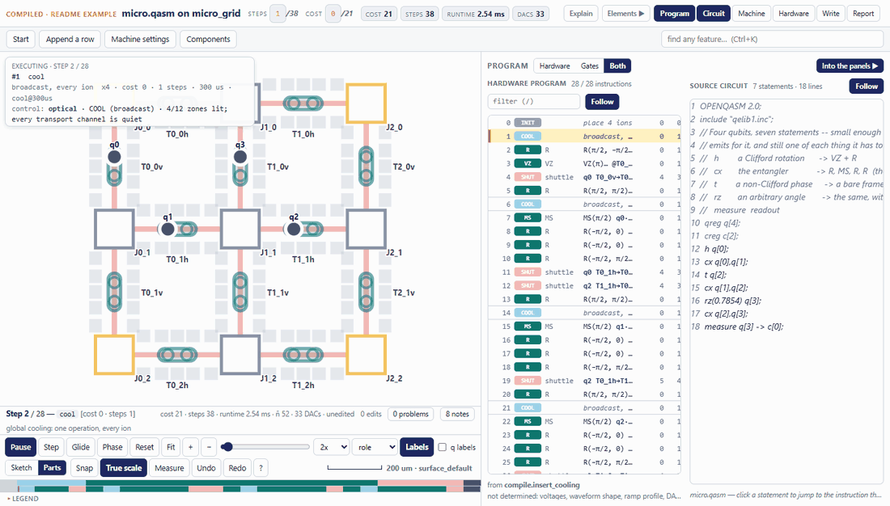
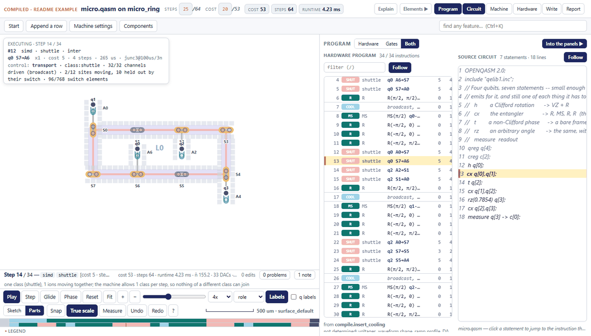
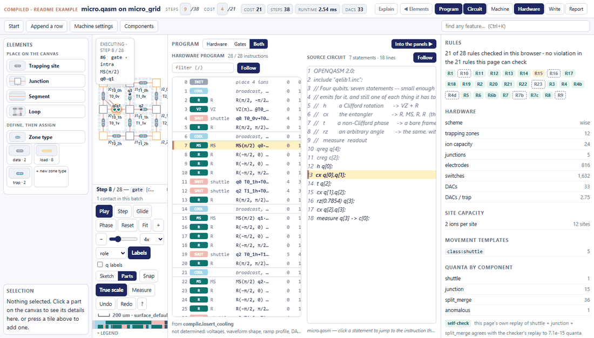
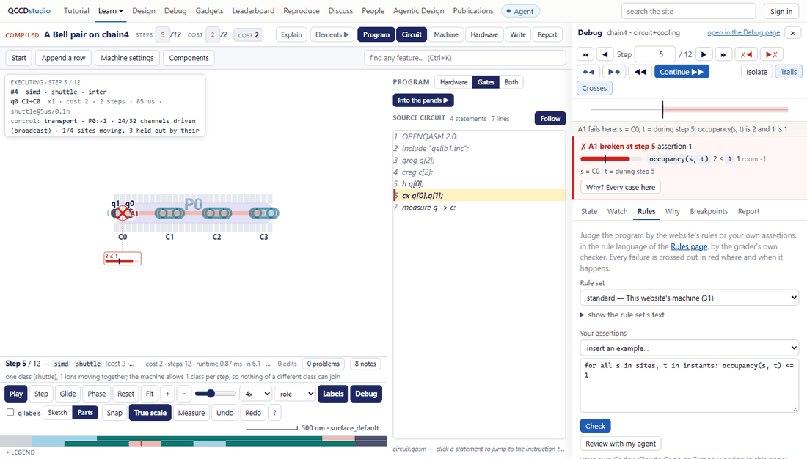

<div align="center">

# QCCD Studio

**A fault-tolerant algorithm and trapped-ion architecture codesign tool**

Design a machine · compile a circuit for it · watch it run · check every step · derive the metal

[](https://www.python.org/downloads/)
[](LICENSE)
[](#install)
[](docs/rules.md)
[](Compiler/)
[](https://qccd.academy/)



</div>

In a QCCD machine, ions are transported between traps to be brought together for gates.
Traps fill up, junctions heat the ions that cross them, and one broadcast waveform drives
every site wired to it identically — so moving two neighbouring ions past one another may
not be realisable at all. Which architecture wins is therefore not self-evident: it depends
jointly on the code, the transport schedule, and the wiring.

**QCCD Studio is a platform for answering that quantitatively.** Describe a machine
declaratively, compile a circuit onto it, and the tool replays the result, checks every
hardware rule, prices it, and derives the electrodes it would take to build. Every program
opens as one page: the machine and its ions, the hardware program step by step, and the
circuit it was compiled from beside it.

The website, **[qccd.academy](https://qccd.academy/)**, runs the same Studio in the browser,
with the tutorial, the rules, the Debug page and the leaderboards.

## Install

No dependencies — pure standard-library Python 3.10 or newer. On macOS the command is
`python3` (and the system one is 3.9: `brew install python@3.13`); on Windows, `py` or `python`.

```bash
git clone https://github.com/yezhuoyang/QCCD.git && cd QCCD
python3 -m qccd devices         # every architecture, and what it costs to wire
python3 -m qccd studio          # the Studio, as one self-contained page
```

The workspace (the Studio paired with your own agent, compiling and local grading) installs
into a virtual environment, with the prebuilt compiler — [docs/workspace.md §7](docs/workspace.md):

```bash
python3 -m venv .venv && source .venv/bin/activate    # Windows: py -m venv .venv; .venv\Scripts\activate
pip install -e ".[agent]"
qccd toolchain install
```

---

## What it can do

### Watch a compiled program run

The clip above is [`Compiler/examples/micro.qasm`](Compiler/examples/micro.qasm) — four
qubits, seven statements — compiled onto a twelve-trap lattice. The stage shows the ions
moving between traps and the gate firing where two of them meet. The card on the stage says
what the current instruction is and what it costs. The **Program** column is the hardware
program beside the circuit it came from (**Hardware**, **Gates** or **Both**). The statement
being executed is highlighted in both, and clicking either one jumps the stage to it.

### Same circuit, different wiring

The same circuit on the same twelve traps, wired as a loop with four docks instead of a
lattice. Only the docks can gate, so the loop has to carry every pair to one:



| same circuit, same trap count | `micro_grid` | `micro_ring` |
|---|---:|---:|
| instructions | **28** | 34 |
| transport instructions | **5** | 11 |
| cost | **21** | 53 |
| runtime | **2.54 ms** | 4.23 ms |
| every hardware rule | passed | passed |
| R10: the proved Lean checker, and the exact unitary of the emitted pulses | **passed** | **passed** |

**1.67× faster on the same number of traps**, and the reason is one row: a lattice gates
where the ions already are, and a ring must carry each pair to a dock.
`python Compiler/bridge/micro_demo.py` builds both machines, compiles, and checks them.

→ [**Compiler/README.md**](Compiler/README.md) for the compiler, the proof, and the SAT oracle

### Design a machine in the browser

Place traps, junctions, segments and loops, or sketch a shape and let the parts fill in. The
cost model and the rules re-evaluate as you go. The **Hardware** pane says which rules hold,
and what the machine takes to build: electrodes, switches, DACs.



→ [**qccd/README.md**](qccd/README.md) for the Python API, the document format and every command

### Check it step by step

The Debug panel judges a program by a rule set, or by assertions you write in the rule
language, with the grader's own checker. A failure is shown like a runtime error: the step,
the place, a red cross on the stage, and how to fix it. Here, two ions share one site at
step 5:



**Review with my agent** lets your own agent (Codex, Claude Code or Cursor) work in the same
panel while you watch. **Run agent review** has your own Claude or ChatGPT account write a
report, in Docker on your computer. Either way, the grader's rule check stays the only verdict.

→ [**docs/debug.md**](docs/debug.md) · [**docs/rules.md**](docs/rules.md) · [**docs/rule-language.md**](docs/rule-language.md) · [**docs/agent-review.md**](docs/agent-review.md)

### Derive the electrodes it implies

A machine plus a technology file determines the metal. Nothing is authored — no `.arch.json`
changes, no field added to a trap. Integer-nanometre polygons, the RF pseudopotential in
closed form, GDSII and SVG from one shape table.

→ [**docs/phys.md**](docs/phys.md) · `python -m qccd phys ring144_24v --svg out/m.svg`

---

## What has been established

| | |
|---|---|
| **R10 is no longer skipped** | *"the compiled program implements the input circuit"* shipped as unchecked, for a stated reason: it needs symbolic permutation and Pauli-frame tracking against a QASM DAG. It is now decided in two halves: a **checker proved in Lean 4** — 23 theorems, no `sorry`, propext the only axiom — that the certificate's transport is legal and brings each gate's own ions together, once and in order; and a check of the emitted pulses (a stabilizer tableau for a Clifford circuit, an exact unitary for a small circuit outside it), executable and not proved, which is the only one to see which gate fires. [How](Compiler/README.md) |
| **72 of 81 verified, 0 defects** | nine circuits × nine architectures, compiled, all rules passing, R10 passed. The nine out of reach decline loudly rather than emitting something illegal. |
| **`BB [[144,12,12]]` compiles** | the individual-ion router stops at 46.2% loop occupancy and the round needs 53.8%. Rigid rotation moves every ion with one instruction: **776 ion-hops** against the shipped pipeline's 2,672. |
| **The shipped artifact reproduces exactly** | 397,184 cost / 8,808 steps, all rules pass — the oracle everything else is measured against. |
| **The junction cost is a checked number** | fed only the two RF widths arXiv:2201.12579 publishes, the field solver reproduces that paper's own naive-junction measurement: **86.5 µm** transport path against their 84. It also finds no shipped machine sits at its design ion height — neighbouring metal moves it by up to 15%. |
| **Zero dependencies** | the core toolchain is standard-library Python. Pages are single self-contained HTML files. |

---

## The leaderboards

Every architecture is compared on the same circuits, compiled and checked the same way. The
**[leaderboards on qccd.academy](https://qccd.academy/board/)** rank the entries per circuit
(memory experiments by logical error rate). Each entry opens as its own Studio page, as above.
The nine reference architectures, all from published designs, are in
[**arch/README.md**](arch/README.md).

---

## What is in the box

| | |
|---|---|
| [`qccd/`](qccd/README.md) | the platform: the language, the IR, the rules, the cost model, the Studio |
| [`qccd/workspace/`](docs/workspace.md) | the local workspace: the Studio paired with your own agent, compiling, grading |
| [`Compiler/`](Compiler/README.md) | QASM → hardware instructions: OCaml search, Lean-verified checker |
| [`arch/`](arch/README.md) | nine reference architectures |
| [`examples/`](examples/) | runnable studies — routing benchmarks, heating budgets, `BB [[144,12,12]]` |
| [`docs/`](docs/) | [design plan](docs/PLAN.md) · [architecture language](docs/adl.md) · [control IR](docs/tsir.md) · [the rules](docs/rules.md) · [the rule language](docs/rule-language.md) · [the electrodes](docs/phys.md) |

## Where this is going

- **Near term** — for `BB [[144,12,12]]`, which architecture is best? The compiler makes
  that a measurement rather than an argument: same circuit, every machine, verified output.
- **Long term** — which code *and* architecture together give the cheapest demonstration
  of break-even?

Contributions welcome — see [qccd/README.md](qccd/README.md#tests).

## License

[MIT](LICENSE)
