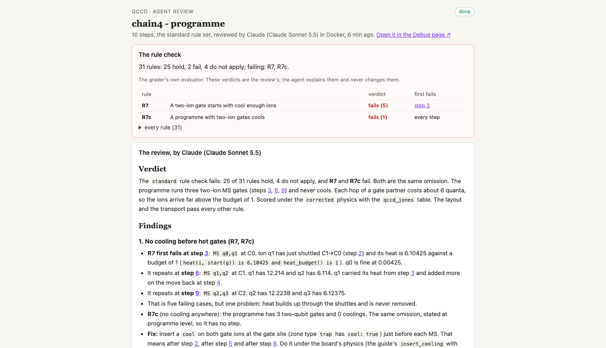

# Agent review: Run agent review, on the Debug page

A person reviews a program with their own agent -- Claude Code with their Claude subscription, or
Codex with their ChatGPT plan -- in Docker on their own computer, and reads the result as a page.
The rule check (the grader's own evaluator, `qccd.debug`) judges every rule first, and its verdicts
are the only ones; the agent explains them: what fails, where, and how to fix it.  Nothing runs on
a server, and QCCD holds no key: the agents' own CLIs sign in and call their own vendors.



## The experience

1. **Debug, Rules tab, Run agent review.**  In the person's workspace -- the Debug panel beside a
   design in the Studio, or any Debug page of the website opened through the workspace
   (`qccd web`) -- the button opens the workspace's review page in a new tab and hands it the
   program the panel shows: the machine, the programme, its clock, the rule set, the person's
   assertions, and the link back.  On qccd.academy itself, the button says how to open the page
   with a workspace (`http://127.0.0.1:47100/web/debug/...`).
2. **Sign in, once.**  The review page lists Claude and ChatGPT, signed in or not.  "Sign in with
   Claude" runs `claude setup-token` in the reviewer image: the page shows the claude.com link, the
   person approves, and pastes back the code that page shows; the subscription token it prints is
   kept and never shown.  "Sign in with ChatGPT" runs `codex login --device-auth`: the page shows
   the link and the one-time code.  Docker is the only thing to install: not the CLIs.
3. **Run.**  The rule check's verdict is on the page within a second or two; then the agent's
   progress, line by line (what it reads, which debugger command it runs); then the report.
4. **The report** (`/reviewview/<id>`): the rule check (failing rules first, each with the step
   where it first fails), the agent's review (Verdict, Findings, Close calls, Beyond the checkers,
   Next steps), its notes by step, and how it ran: the model, the time, the tokens, the hosts the
   container reached and those it was refused.  Every "step N" is a link to the Debug page at that
   step, with the check on.  "Review it again", or "with ChatGPT"/"with Claude", reruns the same
   program.

## The verdict is never the agent's

The review's verdicts are the rule check's: `python -m qccd.debug ... check`, the evaluator the
grader and the Debug page run, on the same documents the page had open.  The agent is told them,
reads them (`check.json`), and is asked to explain them, never to change them; the page shows the
rule check above the agent's text, from the service's own copy.  A review that fails, times out or
is cancelled leaves the rule check standing.

## Isolation

A review runs in a container of its own, from the reviewer image (`qccd/review/image/`: Node with
the two CLIs at pinned versions, Python for the debugger, the egress proxy), built on the person's
computer the first time a sign-in or a review needs it -- a few minutes, once.

- **Network**: the container is on a Docker network of its own, `--internal`: no route out.  A
  proxy container on that network and the default one lets `CONNECT` through to the agent's own
  vendor only (Claude: `api.anthropic.com`, `claude.ai`, `claude.com`, ...; ChatGPT:
  `chatgpt.com`, `auth.openai.com`, `api.openai.com`), port 443 only, and logs every request.
  The report lists the hosts let through and those refused.
- **Files**: it sees the review's folder (a temporary one, outside any repository or workspace:
  the programme, the guide, `out/`), the agent's own profile, and qccd's Python read-only (for
  the debugger) -- nothing else of the computer.
- **Process**: a read-only root, no capabilities, no new privileges, pid, memory and CPU limits,
  the person's own uid.  Inside, the CLI's own sandbox is off (the container is the sandbox) and
  none of the person's setup is read: no user config, rules, memories, MCP servers or hooks.
- **The token** goes in by name (`-e CLAUDE_CODE_OAUTH_TOKEN`, its value in the docker client's
  environment): it is never in a command line.  What the review keeps of the agent's work is
  checked for anything that looks like a credential first, and that is removed.

Every container and network a review or a sign-in makes is labelled with the process that made it.
A stopping service removes its own; what a process that died left is removed by the next review
or sign-in, never another live one's.

## Signing in

Each agent signs in once, into a profile of the review's own in `~/.qccd/reviewers/` (`QCCD_HOME`
moves it), shared by every workspace on the computer and readable by the person only.  Their usual
Claude Code or Codex, and its sign-in, are not read or touched.

| Agent | Sign in | Kept as |
|---|---|---|
| Claude (Claude Code) | the page's "Sign in with Claude", or `qccd review login claude` (`--token`: a token `claude setup-token` printed before, on stdin) | `reviewers/claude/oauth-token`; Claude Code's own state in the container is `reviewers/claude/home/` |
| ChatGPT (Codex) | the page's "Sign in with ChatGPT", or `qccd review login codex` (a device code; if a ChatGPT account has device codes off, it turns them on in its security settings) | `reviewers/codex/auth.json` (a file: a container has no keychain) |

A Claude subscription signs in only to Claude Code itself, and a ChatGPT plan only to Codex, so
the CLIs do the signing in and the calling -- on the person's computer, with their account.  A
server could not, and needs not: the grader decides there.

## Who may do what

Only a person starts a review or signs an agent in: both spend their own subscription, and the
routes are `human_only` (an agent's token is refused).  An agent reads reviews: `qccd_get_review`
(the list; one review with its rule check, report and notes).  To have one, it asks the person to
press Run agent review.  A page never starts one either: on the website mirror the Debug page is
another, untrusted origin, and it only opens the workspace's review page and hands the program
over (`postMessage`, accepted from the workspace's own pages and the mirror only); the person signs
in and runs it there.

## At a terminal

    qccd review status                                   Docker, the image, who is signed in
    qccd review login claude | codex                     the same sign-in, at the terminal
    qccd review run --arch M.arch.json --program P.tsir.json [--agent codex] [--rules standard] [--wait]
    qccd review list | show <id>                         this workspace's reviews
    qccd review logout claude | codex

## What a review keeps

A folder in the workspace, `.qccd/reviews/<id>/` -- no database table, so a workspace a review
touched opens with any QCCD: `request.json` (title, rule set, assertions, link back, agent and
model), `input/` (the machine, the programme, its clock), `state.json` (status, progress, model,
usage, egress, error), `summary.json` and `check.json` (the rule check), `review.md` and
`notes.json` (the agent's report).

## How it is built

| piece | where |
|---|---|
| the two agents, their profiles and sign-in (in the image, through `script`) | `qccd/review/agents.py` |
| Docker: the image, a sign-in's container, a review's network, proxy and container | `qccd/review/container.py`, `qccd/review/image/` |
| one review: stage, rule check, the agent, what is kept | `qccd/review/engine.py` |
| the workspace's reviews, sign-ins and their routes | `qccd/workspace/reviews.py`, `service.py` (`/review/new`, `/reviewview/{id}`, `/api/reviews`, `/api/reviewers`, `/api/signins`) |
| the review page | `qccd/workspace/web/review.js`, `review.css` |
| the button and the hand-over | `qccd/site/debug/debug.js` (`runAgentReview`); the hosts say where the page is: `web/cowork.js` (Studio), `web/mirror.js` (website) |
| the agent tool, the CLI | `features.py` (`qccd_get_review`), `cli.py` (`qccd review`) |
| tests | `tests/test_agent_review.py`, with a stand-in Docker (`tests/fake_docker.py`) |

## Try it

From a clone, with Python 3.10 or newer and Docker running:

```bash
pip install -e ".[agent]"
qccd init my-designs && cd my-designs
qccd web            # the website through the workspace: open Debug, a program, Rules, Run agent review
```

or `qccd studio`, then Debug beside a design that has a programme.
